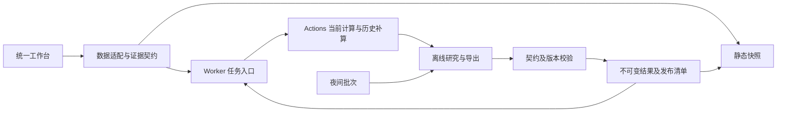

# 临界点：网站设计与时间—价格研究交付

日期：2026-11-05。审计基线：`CareyPang/LPPL@7bde4f4f81793cb9148952859e21eace601a6905`。关联 [Issue #48](https://github.com/CareyPang/LPPL/issues/48)。本包是文献/源码研究、完整设计规范和可运行离线原型；不是生产网站改版或新模型回测结果。

## 阅读与运行

| 产物 | 内容 |
|---|---|
| [执行 Prompt](EXECUTION_PROMPT.md) | 可直接交接的完整任务书、范围、证据要求、执行步骤与交付门禁 |
| [网站设计规范](website-design-spec.md) | 页面架构、品牌/行情颜色、浅深主题、图表、字体与间距、四断点、空/错误/异步状态、移动端与验收 |
| [后端设计](backend-design.md) | 任务身份、数据契约、Worker、Actions、缓存、发布一致性与扩张条件 |
| [时间层研究](time-layer-research.md) | JLS/LPPLS、MPL、GSADF、生存/竞争风险、Hawkes、Markov、标签时钟与可否决实验 |
| [价格层研究](price-layer-research.md) | 条件分位、波动/EVT、首达、估值、负LPPL、Ising/势阱、conformal、交易可达性 |
| [联合执行协议](joint-protocol.md) | 两个候选的优先级、冻结项、主检验/预算、工程与研究分开执行、1周/1月/3月路线 |
| [交互设计稿](prototype.html) | 纯本地HTML，零依赖、无网络行情、全部合成示意；可切主题、色序、研究层、资产与状态 |
| [验证记录](VALIDATION.md) | 本轮实际做过什么、发现并修了什么、哪些未做，及后续生产验收清单 |

下载同目录文件后用浏览器打开 `prototype.html`；或在此目录运行 `python -m http.server 8786 --bind 127.0.0.1` 后打开本地页面。GitHub的文件查看器不会执行HTML。原型的文档链接在本地服务器中通常显示/下载Markdown，这是交付附件导航，不是已实现的生产文档中心。原型不引用任何第三方脚本，不访问Worker或真实行情。

## 设计决策

**设计建议：保留墨绿品牌，用中性图表底板和独立行情色解决冲突。** 当前源码将绿色复用于下跌、通过和命中；这属于语义冲突，不必因此抛弃品牌。浅深主题共用语义：墨绿/鼠尾草绿用于界面身份，红绿仅表示明确选择的涨跌；时间情景紫色，价格区间金色；研究证据以文字和图形表示，不借用“行情绿=成功”。完整色值和对比度在设计规范中。

统一一个工作台及资产选择器，区别交易所/资产类型；指数和个股共享骨架。#44/#47先合并入口设计与数据契约，再选组件，不能并列发布两个个股产品。首页保留水波意象，分析页去除大媒体；移动端保留导航、证据和状态，不把桌面压缩成小字。

**VERIFIED（浏览器观察）：** 已检查原站首页、终端和个股入口；终端390px存在横向滚动及图内文字拥挤。**VERIFIED（原型检查）：** 新原型四断点无页面级横向溢出，移动端保留证据列；这些结果不代表生产网站已修复。

## 研究决策

| 问题 | 结论与证据边界 | 下一步 |
|---|---|---|
| 能否从tc直接给精确顶日？ | VERIFIED（文献）：临界参数、随机崩盘、事件时间不是同一对象；NOT_ESTABLISHED：项目已有跨市场精确周级预测能力 | 保留描述性结构；事件时间单独标注与评价 |
| MPL是不是自动校准的置信区间？ | VERIFIED（原文）：原论文5%相对似然截断不等于95%峰值覆盖；项目χ²区间是需独立标定的实现选择 | 方法、对象、名义水平和实测覆盖分别显示 |
| 能否从负LPPL或势阱算底价？ | NOT_ESTABLISHED：exp(A)没有本项目底价校准；VERIFIED（推导）：静态密度不能单独识别动态时间尺度 | 不上线“精确底价”；冻结现有失败路线 |
| 优先研究哪两项？ | 设计建议/NOT_ESTABLISHED：Q收缩条件分位、C显式终止事件的竞争风险 | 先修标签与基线，再检验条件增量；最多两条主候选 |
| 能否靠conformal保证每只股票？ | VERIFIED（文献）：边际/长期覆盖不等于逐股票逐期条件保证，延迟反馈需另处理 | 首期只做经验校准；不挂理论保证徽章 |
| 1990s及主要全球指数是否全测完？ | VERIFIED（仓库）：相关README仍为冻结/未评价，不能把下载完成称全量回测 | 保留确认集访问记录，未经冻结协议不用于选模型 |

以上判断及原始论文链接详见两份研究报告。PR作者报告的性能数值没有在本轮独立复现；H1/H2/H3、Q2、MPL、Ising、Q-DD2、PPE失败结果保持。

## 前后端边界

**设计建议：** 保留现有技术骨架；先补job_id、两阶段状态、源SHA、输入hash、缓存失效与原子清单，不立刻引入微服务或实时行情。数据新鲜度、计算成功和研究有效性是三个独立维度。未核查的生产绑定/分支保护为NOT_INSPECTED，不从配置文件存在推断线上生效。

## 本轮执行边界

已执行：源码与真实页面检查、原始论文关键章节核验、设计规范、后端方案、两层研究、协议草案、交互原型、独立静态复核与浏览器验证。

**NOT_RUN：** 新金融模型、优化器对照、参数重拟合、全量回测、概率校准及交易策略验证。没有新模型效果数字。协议仍是待冻结草案，不能把本PR提交时间自动当作已开始前瞻预测记录。

本PR只提交本目录文件；不改变生产frontend/research/workers，不合并、不触发生产发布。后续工程修复、模型实验及网站上线各自拆分。GitHub现有CI可能按仓库规则自动运行，其通过只代表对应检查通过。
