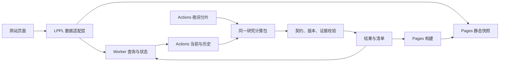

# LPPL 网站后端与数据契约设计

日期：2026-11-05。事实基线：`CareyPang/LPPL@7bde4f4f81793cb9148952859e21eace601a6905`。

本文件只做架构规划。VERIFIED 表示核实固定提交中的代码或文档，不表示已经验证生产配置、端到端服务质量或模型预测能力。PROPOSAL 表示拟议改进；NOT_ESTABLISHED 表示证据尚不足。本轮没有改代码、运行模型或发布网站。

## 1. 结论

**PROPOSAL：保留 Pages 静态站、唯一前端数据适配层、Worker 任务入口、Actions 计算、stock-results JSON 的骨架。** 优先补齐任务身份、阶段状态、数据与模型版本、发布一致性。当前规模无需数据库集群、微服务、实时推送或大型调度平台。

产品必须分别告诉用户：数据是否新、计算进行到哪、研究证据能支持什么。单一绿色“成功”不能同时代表这三件事。

## 2. 固定提交中已核实的事实

| 状态 | 事实 | 设计含义与证据 |
|---|---|---|
| VERIFIED | frontend 页面通过 LPPL 适配层读取 JSON，不计算模型；旧接口文档已废弃 | 保留单一适配层，不恢复浏览器模型回退。[适配层](https://github.com/CareyPang/LPPL/blob/7bde4f4/frontend/app/lppl-data.js)、[协作规则](https://github.com/CareyPang/LPPL/blob/7bde4f4/frontend/AGENTS.md) |
| VERIFIED | Worker 提供 /query、/status、/result；公开请求固定 stk_lite、104 周；令牌不交给浏览器 | Worker 适合作为轻量入口，不承担数学计算。[源码](https://github.com/CareyPang/LPPL/blob/7bde4f4/workers/stock-query/src/index.js) |
| VERIFIED | stock_query 有当前计算、当前发布、历史计算、历史发布四阶段 | 当前结果先显示、历史后补应成为正常产品状态。[工作流](https://github.com/CareyPang/LPPL/blob/7bde4f4/.github/workflows/stock_query.yml) |
| VERIFIED | Worker 按代码、since 和最近 workflow 匹配任务；返回整条 workflow 状态 | 当前没有稳定 job_id；不能把整个 workflow 成功等同于特定结果已对用户可读 |
| VERIFIED | 多个计算/发布 job 分别 checkout main | 建议任务开始时锁定源提交，防止两阶段跨代码版本 |
| VERIFIED | 结果写 stock-results；Pages 构建把该分支覆盖到 lab/mock/data/stock；两次发布分别触发 Pages | 保留独立结果分支，改善发布版本与读取一致性。[发布脚本](https://github.com/CareyPang/LPPL/blob/7bde4f4/scripts/publish_stock_result.sh)、[构建脚本](https://github.com/CareyPang/LPPL/blob/7bde4f4/scripts/build_site.sh) |
| VERIFIED | getJSON 将成功 Promise 保存在页面内存；Worker 结果响应标 max-age=30 | 最新指针需要刷新机制；不可变历史与最新结果应使用不同缓存策略 |
| VERIFIED | LPPL.ev 使用隐藏名单，未知证据字符串默认 show=true | 建议未知等级默认不放行数值，改为明确允许名单 |
| VERIFIED | nightly 已有固定 asof、分片，以及汇总日期一致性和缺失校验 | 增强覆盖率、排除原因和版本可读性，而非重建批处理系统。[nightly](https://github.com/CareyPang/LPPL/blob/7bde4f4/.github/workflows/stock_nightly.yml) |
| NOT_ESTABLISHED | 生产 Worker 的绑定、限额与令牌权限，分支保护实际生效状态，端到端耗时 SLA | 必须通过部署后的只读配置检查与授权验收另行证明；源码存在不等于线上生效 |

## 3. 目标架构（PROPOSAL）

仍放在同一仓库，按职责分六层：

1. 数据层：行情、因子、交易日历、冻结数据、质量及来源记录。
2. 研究计算层：拟合、过滤、情景和历史帧；不处理网页文案。
3. 导出层：稳定契约、证据适用范围、可显示内容。
4. 任务发布层：调度、缓存、阶段状态、校验、发布、回滚。
5. 前端适配层：统一读 Pages/Worker、核对版本、转换显示字段。
6. 页面层：搜索、状态、场景、历史、证据解释；不拼原始 URL 或重算模型。

## 4. 状态与任务身份（PROPOSAL）

三种状态分别表达：

- 数据：当前交易日、沿用旧数据、部分缺失、不可用。
- 计算：排队、当前计算、当前可读、历史计算、完整可读、部分成功、失败。
- 证据：描述性、研究候选、开发段信号、样本外未通过、确认通过。现有失败状态不因重新计算或 UI 改版自动升级。

推荐状态机：

`queued → current_running → current_publishing → current_ready → history_running → history_publishing → complete`

- 当前失败：failed_current；可显示上一次有效结果及其日期。
- 当前可读、历史失败：partial_success；保留当前卡片。
- 计算成功、发布失败：publish_failed；不能宣称更新完成。
- 浏览器等待超时：只停止本页等待，不能把后台任务改判失败；刷新后恢复跟踪。

最小实现仍可使用 JSON 任务清单，无需数据库。建议至少包含：

`job_id, symbol, requested_at, source_sha, model_version, data_cutoff, variant, current_status, history_status, result_id, error_code, updated_at`

Worker 返回 job_id，Actions 将其写入当前、历史和错误产物。所有轮询围绕该任务。百分比只在已知分母时显示，例如已完成历史帧数；未知时只显示阶段。耗时只报告实测分位数，不承诺固定 1–2 分钟。

## 5. 数据契约、证据与缓存（PROPOSAL）

- 标的身份由交易所、代码、资产类型组成；000001 的指数与股票不得混淆。支持市场由能力清单定义，不能只靠六位代码。
- 结果带 schema_version、source_sha、model_version、filter_version、data_version/input_hash、asof、generated_at、variant、result_id。
- 当前与历史必须有明确兼容关系。新模型当前结果不能静默拼接旧模型历史。
- 历史帧记录 asof、输入截止、生成时间。事后重算曲线与当时实际发布记录分开；前者不称前瞻预测日志。
- 区分 null、0、无合格拟合、行情缺失和任务未完成。未知等级默认不显示受限数值。
- 每模块引用 evidence_id：适用市场、时间、模型、评价方法、报告及显示规则在统一证据清单中维护。
- 分离三类对象：不可变分析结果、最新指针、任务状态。不可变结果可长缓存；最新指针短缓存并可重新验证；任务状态不被页面永久缓存。
- 拟合缓存键覆盖输入哈希、模型与过滤配置、窗口、asof、代码版本。新结果先校验，最后更新清单指针；旧任务迟到不得覆盖更新结果。
- 保留可回滚快照。历史仍可读取但过期时，应明确写出历史截止和版本，而非直接隐藏全部信息。

## 6. Worker 与发布最低要求（PROPOSAL）

- 公开入口保持固定预算；昂贵全尺度与长历史计算归研究操作。
- 当前代码无 KV 绑定时继续派发并标 ratelimit=disabled。建议生产环境缺少限流能力时拒绝新派发，继续提供静态结果。
- CORS/Origin 检查不是身份认证；没有 Origin 的请求可访问当前接口。算力保护须依靠限流、去重、全局预算和熔断。
- KV 去重目前不构成严格原子锁；小规模可作为尽量去重措施，并有工作流预算保护。只有需要硬性任务唯一性时才引入原子预约机制。
- GitHub 令牌只留服务端；读取与派发权限尽量拆分。公开错误使用标准码和可读说明，不以完整原始 stderr 作为用户文案。
- 计算 job 只读、发布 job 单独写结果；PR smoke 不发布。输入白名单在 Worker、Actions、计算入口一致。
- 任务开始锁定 source_sha、data_cutoff 和配置，贯穿所有阶段。Pages 构建清单记录站点提交、结果提交、构建时间。
- Pages 当前 fetch stock-results 的失败由 `|| true` 吞掉。应区分首次无分支与已有结果读取失败；后者不能静默发布缺数据版本。[Pages](https://github.com/CareyPang/LPPL/blob/7bde4f4/.github/workflows/pages.yml)
- 当前结果通过 Worker 可直接读取，因此无需等整站重建才显示；规模增加后再合并 Pages 构建请求。

## 7. 何时再扩张（PROPOSAL）

| 实测触发条件 | 后续能力 |
|---|---|
| 重复派发和状态竞争频繁 | 原子任务存储、持久队列、job 表 |
| 文件量导致 Git 提交、读取、历史体积成为瓶颈 | 不可变结果对象存储，轻量清单 |
| Actions 排队或预算持续损害查询体验 | 独立计算 worker，沿用现有研究包和导出契约 |
| 真正需要跨设备自选、提醒、多人权限 | 用户认证与数据库；当前本地自选不要求账户系统 |
| 实测轮询压力明显 | 状态汇总缓存，必要时再做推送 |

## 8. 监测与验收（PROPOSAL）

先用结构化日志、Actions 摘要和状态清单，记录排队、当前、历史、发布阶段的 p50/p95、缓存命中、数据源失败、发布失败、数据过期和每日计算预算。

- [ ] 同代码重复点击、不同代码并发、页面关闭重开，仍关联正确任务。
- [ ] 冷/热缓存都能先显示当前、后补历史；历史失败保留当前。
- [ ] 旧任务晚完成不覆盖新结果；当前、历史、页面清单版本可核对。
- [ ] 不可达数据源、停牌、未收盘、因子缺失、数据过短都有明确状态。
- [ ] nightly 缺片、股票失败和 asof 不一致不冒充全量覆盖；分母、有效数、缺失数、排除数可见。
- [ ] Worker 非法输入、限流、KV 故障、派发失败、404 均有稳定响应。
- [ ] Pages 真实 URL 的版本等于预期；失败能保留上次有效发布。
- [ ] 桌面与 390px 验收成功、排队、过期、空、错误、部分成功状态。
- [ ] 证据规则贯穿契约与组件：失败不显示预测概率；情景不称精确顶日；历史分位有 n；缺失不代表安全。
- [ ] 分支保护、必需 CI、发布权限和生产绑定经实际检查，不只审配置文件。

## 9. 执行边界

这份文件是设计建议，不是已完成迁移。PR、推送、发布及模型执行应按当前用户授权分别处理；本研究子任务没有进行任何远端写操作。
