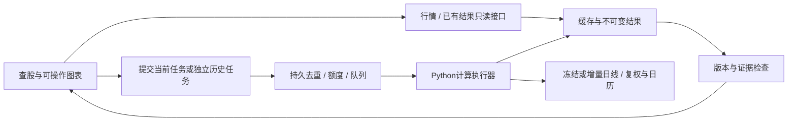

# LPPL 完整开发规划与当前进度

> 历史版本：用户已要求从需求重新规划，并进一步明确以双尺度顶部时间区间为核心、不以跌10%为成功条件。当前执行依据是[顶部时间产品规划](2026-11-06-top-time-product-plan.md)。本文保留为当时的状态与旧路线记录，不再决定后续优先级。

核查日期：2026-11-06。main 基线：`12292944289343f6dbda65db1cf160f3736052cd`。本轮开始时 PR #50 为 `339ebb170db5dd7d078bbeff9877843ba24e515f`，后续窗口与聚类代码仍更新在同一草稿 PR；以 PR 最新提交及对应 CI 为准。

## 1. 现在到哪一步了

**VERIFIED：项目已经有可访问的网页、个股计算代码和运行过的后台流水线；PR #50 已完成“先看行情和缓存、当前分析与104周历史分开”的工程实现，以及振荡单位和已有拟合重筛。现在处于“工程原型已具备、模型研究迭代、生产验收尚未完成”的阶段。** 不能写成“完整预测产品已完成”，也不是从零开始。

本轮只读刷新了 GitHub 全部49个实际 PR 的索引（编号1–47、49、50；编号48未出现在PR索引）、全部7个开放PR的状态/文件清单/现有CI、main/Pages/Actions元数据，并核对相关本地源码。**NOT_INSPECTED：本轮不是对49个历史PR的所有diff重新逐行审计，未进入Cloudflare账户、腾讯云账户或管理员设置，未发起新生产计算、合并或发布。**

证据标记：**VERIFIED**=本轮读取的代码、API、文件、测试/重筛证据；**PR 作者报告**=既有报告中的执行或效果陈述，本轮没有重跑；**NOT_ESTABLISHED**=能力或效果未被证明、建议尚待验收；**NOT_INSPECTED**=本轮没有检查。建议和计划统一视为 **NOT_ESTABLISHED（待实施/验收）**，不是完成事实。

### 进度总表

| 层 | 已有成果与真实位置 | 仍未完成 | 当前判定 |
|---|---|---|---|
| 用户需求 | 普通投资者；A股代码查询；日线；持有1–6个月；希望至少提前5交易日提醒、时间窗最好≤10交易日；偏向少漏报；关注普通约10%调整 | “普通调整”的完整事件定义、观察期限、假报警代价仍需形成一个明确版本；不能默认采用60日跌10% | **VERIFIED（对话需求）**，性能目标 **NOT_ESTABLISHED** |
| 网页与主站 | main已合并#46海水首页；主页/stock.html本次HTTP200 | PR50交互尚未发布；真实大陆访问速度、真实390px设备、完整可访问性未完成 | **VERIFIED** 页面可达；生产体验 **NOT_ESTABLISHED** |
| 个股后端 | #23/#25/#29/#34/#37已合并：代码识别、取日线、后复权、北交所回退、当前/历史计算 | 名称回退#45未合并；PR50缓存/任务协议未部署；数据源长期稳定性及完整商用授权未核实 | **VERIFIED（代码/合并状态）** |
| 首屏与等待 | PR50：行情、缓存当前结果、历史分开加载；默认history_weeks=0；用户另点历史才计算 | 新Worker/工作流/前端三者真实环境联合验收 | **VERIFIED（代码及已有测试证据）**，线上新流程 **NOT_ESTABLISHED** |
| 任务与缓存 | PR50：持久任务、去重、全局/IP额度、源码SHA、不可变任务结果、较新结果保护、当前/历史共享拟合缓存 | 云端迁移演练、过期任务回收、取消/恢复运维流程、存储保留期 | **VERIFIED（实现）** |
| Cloudflare Worker | main仍是旧RL KV配置；PR50改为两个Durable Objects绑定 | 新绑定/migration/secret/CORS真实验收；公开结果接口本次一次GET返回502 | **VERIFIED** 单次失败；不能据此推断全服务长期不可用 |
| 算力 | 目前科学计算仍由GitHub Actions承担；既有nightly schedule有成功运行 | 腾讯云/阿里云计算进程迁移和容量压测尚未做；买云电脑不会自动迁移计算 | **VERIFIED（仓库与运行元数据）** |
| 数据基础 | 冻结价格、外部指数、1990s校核及修正版代码/文件存在；本轮已有6指数原fit已可读取 | 严格PIT、修订行情、历史成分、退市/停牌与真实可交易日的长期审计；#39旧版缺陷注释未合并 | **VERIFIED（文件/代码存在）**；“完整严格PIT” **NOT_ESTABLISHED** |
| 市场背景 | #24/#31/#33已合并板块、涨停池、两融、估值等接口与页面 | 每接口新鲜度、单位、失败回退、缺值展示、生产长期可用性 | **VERIFIED（实现）**；不是预测增益证据 |
| 时间层研究 | 完整周期API、旧值兼容、1.5/2.5重筛已完成；用户已指定1.5作为研究基线；本轮窗口/跨尺度描述性比较已完成 | 等报警成本比较、真实事件协议和独立验证待完成；研究结果不能直接变成生产买卖指令 | **VERIFIED（已有成果/研究基线决策）**；预测能力 **NOT_ESTABLISHED** |
| 价格层 | main有P1历史回撤/估值带、B/W卡、dip相似事件面板；有Q-DD2/PPE研究 | 条件回撤区间、破裂后价格区间、抄底辅助的独立有效性与实际产品统一 | **VERIFIED（代码）**；模型成绩仍按失败/描述性处理 |
| 运营与商业 | 有公开站、代码和研究报告 | 域名/主体/备案路径、合法数据使用、账号/收费/退款/客服/成本与权限边界均未完成 | **NOT_ESTABLISHED / NOT_INSPECTED** |

位置图（不是按代码行数估算的百分比）：

```text
需求成形 → 研究和页面原型 → 异步查询工程 → 真实环境验收 → 小范围研究工具 → 付费工具
             已有            PR50已实现       当前待跨越          未完成       未开始
                 └─ 1.5周期基线 → 窗口/跨尺度研究 → 独立验证/前瞻记录 ─┘
```

## 2. 本轮实际核查到的上线与权限状态

**VERIFIED：**GitHub Pages配置为workflow构建，来源main；[最近核查的成功发布](https://github.com/CareyPang/LPPL/actions/runs/42086350061)为main `1229294`。当前公开`stock.html`没有PR50新增的`stock-session.js`，所以不能拿线上旧页的存在当作新交互已上线。

**VERIFIED：**PR50起始提交`339ebb1`的[PR CI](https://github.com/CareyPang/LPPL/actions/runs/42156760627)、[push CI](https://github.com/CareyPang/LPPL/actions/runs/42156754355)、[stock_query smoke](https://github.com/CareyPang/LPPL/actions/runs/42156760574)、[stock_nightly smoke](https://github.com/CareyPang/LPPL/actions/runs/42156760515)通过，publish作业跳过。这是该提交的工程检查，后续提交须看自己的CI。

**VERIFIED：**旧main的nightly最近核查到`42082480251`与`42076499929`为schedule成功；旧公开查询`41931717680`等为repository_dispatch成功。**NOT_INSPECTED：**本轮没有逐只核验这些批次的全部产物、行情截至日与模型有效性，不能仅凭绿色运行推断“800只股票全部最新有效”。

**VERIFIED：**公开Worker的只读`GET /result?code=600519&kind=latest`本次返回502、`GitHub result lookup failed`。这只定位到一次结果读取失败，未确定是凭据、权限、路径、上游临时故障或其他问题；没有发送`POST /query`。下一步应从Worker日志和对应stock-results文件定位原因。

**VERIFIED：**branch API返回`main.protected=false`，含父级查询的rulesets列表为空。**NOT_INSPECTED：**进一步读取传统branch protection详情返回403，当前令牌不能看到该管理员接口。上线前必须实际确认并启用review、required checks及发布权限隔离，不能把普通CI配置等同为已强制分支保护；本轮未修改保护设置。

证据快照：[PR与文件/CI索引](evidence/2026-11-06-github-status.json)、[Pages、Actions、保护及公开HTTP核查](evidence/20261106-progress-snapshot.json)。HTTP核查是本机网络单点结果，不能代表大陆多运营商体验。

## 3. 产品应该形成什么样的完整流程

以下是 **NOT_ESTABLISHED（产品实施方案）**。入口只保留一套正式个股流程：

1. 输入代码后立即显示识别出的名称/交易所、行情加载状态、已存在结果日期；不等待模型完成才创建页面。
2. 行情先到就展示K线；当前研究结果先到就展示研究状态。任一通道失败，另外通道继续工作。
3. 清楚区分“截至哪一天的数据”“什么时候计算”“是否已有结果”“后台在算什么”。不能用过期结果写“今天安全”。
4. 当前分析计算只做当前截止日；104周回放、bootstrap、长研究任务通过独立按钮进入低优先级队列。
5. 用户等待时能缩放/拖动K线、查看历史结果和方法说明、切换股票；后台任务状态放在不阻塞操作的任务栏。完成再更新对应资产，迟到响应不能覆盖新资产。
6. 顶部风险、未来回撤情景、破裂后的价格区间、止跌确认分为不同卡。每卡说明是历史描述、未校准研究还是已有外部验证，不把三个问题合成一个“买/卖”分数。

### 页面与视觉

**NOT_ESTABLISHED（设计方案）：**保留海水首页作为品牌层，不需要先推倒重做全站。正式分析页使用中性浅灰/米白或近黑背景，海蓝仅用于导航与交互；涨跌红绿只承担市场语义，避免深墨绿底色吞没绿色K线。A股默认涨红跌绿，国际配色可另设选项；涨跌同时有符号/文字，不能只靠颜色。

| 页面 | 首要任务 | 需要的交互与验收 |
|---|---|---|
| 首页 | 让用户理解并进入查股 | 首屏输入、示例、真实功能入口；视频有poster、加载失败回退、减弱动画选项；不遮挡输入 |
| 个股分析 | 看行情和研究状态 | 图表始终可操作；当前/历史任务独立；分层展开“研究依据”，默认不用数学术语挤占首屏 |
| 市场背景 | 提供解释行情的环境 | 描述性标签、来源/日期、缺值显示；不把资金流变成未经验证的预测分数 |
| 历史与成绩单 | 让结果可核验 | 先选版本/标的/时期，再看当时可见信息；未来事件仅在回放后验层显示 |
| 方法与证据 | 解释为什么能/不能信 | 当前证据等级、失败记录、定义版本、样本数、更新日志；研究原始表可下载 |
| 任务中心 | 让等待可理解 | queued/running/ready/failed明确、可刷新恢复；没有实测进度时不用虚假的百分比 |

**NOT_ESTABLISHED（建议验收目标）：**390px无横向溢出、主要触控目标至少44px、键盘可完成查股及图表日期选择；桌面/移动都支持reduced-motion。冷首屏和热缓存分别测p50/p95，在真实大陆网络记录页面可操作时间、行情可见时间、排队时间、计算时间，暂不宣传“秒级结果”。首页动画不得与任务轮询、K线渲染争抢交互资源。

## 4. 时间层接下来怎样优化

**VERIFIED（本次决定）：**完整周期`omega/(2*pi)*log((tc-t1)/(tc-t2))`，最低1.5，作为研究基线；旧结果仍保留，不直接迁移生产门槛。最近重筛已表明现行v2未来域的1.5门槛机械冗余；2.5增加部分旧事件代理漏报、缩短提前量，不能简单靠提高门槛提高“准确率”。详见[周期重筛报告](../research/2026-11-06-oscillation-units-and-refilter.md)。

**PR 作者报告（本轮未重跑原测试）：**[2022–2025最终测试记录](../../reports/final_test_2022_2025.md)中，LPPLS相关组合未满足原判据，三段综合维持`dev_only`；顶部与底部概率链也有未通过记录。本轮新研究不是已经推翻这些裁定，主模型仍不能作为已验证的精准逃顶/抄底能力宣传。

**VERIFIED（本轮比较协议已执行，预测效果仍未建立）：**使用已保存拟合，先冻结少量候选规则和完整比较表，再执行对照；不在看到某个顶部后倒选窗口或聚类参数，不重用已看过的历史作为新样本外成功证据。

- **时间窗选择**：窗口点数与预测前视距离分别记录；短、中、长按交易日数明确定义。基线保留原6–12月与12–24月档；新增短档时与“只是把更多档取并集”分开比较，避免把报警变多自动说成模型更强。
- **跨尺度聚类**：不同窗口密度先校正；同一日期/窗口只投一票，优化器seed不是独立证据。簇必须能追溯到成员窗口、尺度覆盖和固定分母；输出的是拟合支持度，不是见顶概率。
- **提前量**：固定事件清单和真实交易日历；用下一个交易日开始可行动的时点计分，不能把样本内部tc算提前预测。
- **减少漏报的代价**：一起报告至少提前5日的事件覆盖、普通漏报、报警天数/次数、无事件报警、提前量分布，以及10日窄区间的覆盖。需要更早但更宽的结果时应如实显示；不得事后把每个区间裁到10天制造达标。
- **统计与产品分离**：先在开发数据做敏感性分析；参数冻结后才安排未消费样本或前瞻日志。历史上观察过的1990s、外部市场或某个“当时命中案例”不能通过换文件名恢复独立性。

**VERIFIED（本轮研究完成）：**已实现完整周期1.5、四档95窗口与固定28窗，以及九组窗口/聚类/连续确认对照，并重用已有拟合完成计分。共同53个旧事件代理中，H60提前≥5日覆盖从两个长档OR的26个增至四档OR的42个，但后者约84%的报警日期未匹配旧目标；跨尺度簇覆盖27个、连续确认14个。首个10日区间联合目标仍很弱，不能说精准逃顶已经解决。完整结果见[研究报告](../research/2026-11-06-window-selection-and-cross-scale-clustering.md)。**NOT_ESTABLISHED：**下一步保留“早期观察＋跨尺度支持”的分层候选，不用连续确认阻断所有初次提醒；研究实现、描述性覆盖改善、独立预测有效仍是三个不同里程碑。

### 模型研究验收门

| 门 | 必须交付 | 不通过时 |
|---|---|---|
| T0 可复现 | 固定1.5周期、输入SHA、源代码版本、策略与参数清单、禁止覆写、全部候选结果 | 修工程，不解释性能 |
| T1 可归因 | 同一事件分母；窗口变化与聚类变化分别做对照；零合格日期保留 | 不宣称改进来自聚类 |
| T2 代价可见 | ≥5交易日可行动覆盖和漏报；报警量、假报警、区间宽度/覆盖；共同命中配对提前量 | 保留为研究候选，不上主预警 |
| T3 可泛化 | 未消费样本来源和使用台账；固定规则一次评价；跨时期/资产/事件簇检查 | 保留负面结果，不再用该测试集调参 |
| T4 可上线 | 单独版本、前瞻日志、产品文案、部署回滚及真实任务验收 | 不升级产品证据等级 |

用户偏少漏报，研究的主比较应突出T2的≥5日覆盖；**NOT_ESTABLISHED：**具体允许增加多少假报警、每月能承受多少提醒，需要看本轮实际代价后形成产品决策，不能默认无限报警即可过关。

## 5. 价格层怎样成为完整功能

**VERIFIED（代码存在）：**`research/price_layer/drawdown_table.py`是历史回撤/估值描述，`bottom_cards.py`承担便宜/确认/收复比例，`e_dev.py`含Q-DD2、尾部概率和PPE研究。**PR 作者报告：**[价格层旧评价](../../reports/price_layer_e_dev.md)、[抄底样本外评价](../../reports/dip_oos_2019.md)保留失败/未通过；本轮没有重跑它们。

以下三层必须分别实施，不能由LPPL的tc推出价格答案：

| 需求 | 第一阶段可交付 | 后续研究对象 | 验收 |
|---|---|---|---|
| 未来可能回撤多少 | 现有历史回撤分位、样本数、时期、是否包含退市、不可用状态 | 只使用as-of已知变量的条件回撤区间，与无条件/波动基线比较 | 区间覆盖、宽度、尾部校准、pinball损失，不能只报命中案例 |
| 泡沫破裂后价格区间 | 清楚选择参考价和复权口径，历史回撤情景映射为“如果…则…”价格带 | 条件分位、首次触及等候选；不恢复失败的Q-DD2/PPE作为既成功模块 | 价格与时间截点一致；样本不足隐藏；区间非目标价 |
| 辅助抄底时机 | “便宜程度”和“止跌确认”分开显示，明确确认可能滞后 | 在既定事件协议下研究确认后继续下跌风险、确认滞后与机会成本 | 首次可执行日、再创新低概率校准、最大不利变动、交易约束 |

**NOT_ESTABLISHED（实施顺序）：**先把已有描述性数据契约与文案统一，再研究条件模型，最后才研究时间/价格联合决策。若候选不胜基线，保留描述性情景，不强行输出底部日期。H1/H2/H3、Q2、MPL、Ising、Q-DD2、PPE的失败结果不因新UI或聚类试验而升级。

## 6. 前后端与算力的目标架构



**VERIFIED（现有实现）：**PR50的Worker承担I/O、任务协调、缓存与额度，科学计算仍在Actions；不是一台自动运行SciPy的“Cloudflare云电脑”。**NOT_ESTABLISHED（架构建议）：**继续把HTTP服务与重拟合执行器隔离；Workers有明确CPU/内存等运行限制，Durable Objects可提供带持久存储的协调，但是否适合某个负载要压测，不能从品牌名称推断算力。[Workers限制](https://developers.cloudflare.com/workers/platform/limits/)、[Durable Objects定义](https://developers.cloudflare.com/durable-objects/concepts/what-are-durable-objects/)

| 方案 | 适用阶段 | 优点 | 代价与退出条件 |
|---|---|---|---|
| A：现有Pages＋Worker＋Actions | 开发与小范围试用 | 复用现有实现，改动较少 | 境外链路与排队耗时需实测；重计算不作为首屏前置；商业阶段另审托管限制 |
| B：独立CPU执行器＋同一任务/结果契约 | 下一步优先验证 | 当前任务不再等待Actions启动；可控制当前/历史/夜间优先级 | 需要运维、日志、备份、服务健康、凭据管理；云品牌/地域以实测决定 |
| C：网页/API/执行器分别部署，账号和对象存储 | 用户量及收费阶段 | 更清晰的权限、扩容和计费边界 | 运维复杂度更高；没有负载证据前不先上Kubernetes或大规格机器 |

**NOT_ESTABLISHED（采购建议）：**先用一台普通CPU Linux实例进行同输入的冷/热缓存与并发基准；4核8GB可作为试验档位，不能当成已验证容量。腾讯云/阿里云选择以大陆三网访问、行情源可达性、计算耗时和完整月成本比较，单次活动价不能代替长期成本。已有[腾讯云采购说明](../validation/2026-11-06-tencent-purchase-note.md)有带日期的官方来源，本规划不更新或重复报价，也没有购买资源。

**NOT_ESTABLISHED（大陆服务路线）：**用户此前表示无域名、无备案、运营主体未定。先完成私有或明确范围的技术验收，再核对公开服务的域名/主体/备案及金融信息与数据授权要求。具体资质和收费业务边界需专业核查；未取得前不承诺某种部署已符合全部要求。

**VERIFIED（托管性质）：**Pages是静态站托管，不执行Python模型；当前构建把frontend复制为根站、web复制为/lab，并可合入stock-results数据。[GitHub Pages官方说明](https://docs.github.com/en/pages/getting-started-with-github-pages/what-is-github-pages)、[`build_site.sh`](../../scripts/build_site.sh)。

## 7. PR整合顺序与拆分方案

**VERIFIED（2026-11-06快照）：**以下head在核查时均有成功CI；它们不一定在最新main上重新跑过完整组合。`mergeable=clean`只说明GitHub当前可机械合并，不证明语义兼容。

| PR | 状态 / head | 范围与重叠 | 处理方案（仅规划） |
|---|---|---|---|
| [#39](https://github.com/CareyPang/LPPL/pull/39) | open，非草稿，clean，`94e7b5f` | 旧冻结版README、project_full_plan；旧进度文字已可能过时 | 先核对缺陷说明，保留数据缺陷事实，把过时进度引到本规划；可独立审查 |
| [#45](https://github.com/CareyPang/LPPL/pull/45) | open，clean，`e821c7c` | stock.py、stock_query.yml、test_stock_engine.py；三处都与#50重叠 | 独立抽出名称回退及测试，在#50新任务协议上整合；不整份覆盖新workflow |
| [#50](https://github.com/CareyPang/LPPL/pull/50) | draft，clean，`339ebb1`（本轮起点） | 异步前后端、Worker、任务协议、研究及证据；与#44/#45交叉 | 保留评审入口；审查划分为计算/发布协议、Worker、前端、研究四单元，部署按依赖顺序 |
| [#44](https://github.com/CareyPang/LPPL/pull/44) | open，clean，`e862e5b` | 重写stock.html；直接与#50冲突交互/状态含义 | 从中提取样式和信息层级，在#50状态模型上重做；不要叠加两套加载和轮询 |
| [#47](https://github.com/CareyPang/LPPL/pull/47) | open，clean，`425b343` | 独立新增stock-editorial.html | 作为设计试验保留；先复用同一个数据/会话组件，再决定保留预览或合并正式入口 |
| [#26](https://github.com/CareyPang/LPPL/pull/26) | draft，**dirty/不可机械合并**，`da669d3` | 35个首页/编辑版/媒体/测试文件；不只是home.html | #46已合并，先剥离已落地海水首页重叠；剩余editorial首页/终端/回测拆独立审查，避免恢复旧媒体控制 |
| [#49](https://github.com/CareyPang/LPPL/pull/49) | draft，clean，`383f4c2` | 设计规范、时间/价格研究、交互原型等10个docs文件 | 文档及原型可先评审；吸收为设计依据，不把原型当生产已实现，不沿用已过时后端假设 |

建议审查顺序：**#39数据事实 → #49设计依据 → #45名称功能与#50后端协议一起整合 → #50Worker及前端 → 从#44提取设计 → #47与#26的独立视觉实验收敛**。#46已合并，不能再按旧计划等待它；#26需要重建差异而非整包再并。

**NOT_ESTABLISHED（发布方案）：**最终上线前先让可信默认分支具备新计算/结果协议，再在独立预览环境验收Worker，最后启用新前端。由于pages.yml监听main的前端变更，直接把整个#50合到main可能自动发布前端；发布顺序须通过拆分或显式发布开关安排。当前用户只授权更新PR，本轮不进行上述合并、保护设置修改或部署。

## 8. 可执行任务清单：按依赖推进

下列“完成”必须满足验收项，不能仅以代码提交为准。所有待做任务是 **NOT_ESTABLISHED（计划）**。

| ID / 优先级 | 任务与负责人类别 | 依赖 | 完成标准 | 当前状态 |
|---|---|---|---|---|
| R01 / P0 | 研究：冻结完整周期1.5基线 | 单位审计 | 公式/域/阈值/版本明确，旧结果不变；新研究工具使用同一基线 | 本轮完成；研究限定 |
| R02 / P0 | 研究：已有拟合的时间窗对照 | R01、原fit | 所有候选并列，固定事件分母与首次可行动时刻；输出漏报/报警量/区间代价 | 本轮完成描述性对照；独立验证未完成 |
| R03 / P0 | 研究：跨尺度聚类对照 | R02共同输入 | 尺度权重、簇成员、覆盖及退化情况可追踪；不把seed/重叠窗当独立票 | 本轮完成代码与对照；不启用生产 |
| E01 / P0 | 工程：定位公开Worker结果502 | 日志/权限只读接入 | 已知请求可稳定读已有结果，失败原因被定位而不是静默清空 | 未完成 |
| E02 / P0 | 工程：#45名称回退与#50协议整合 | 开放PR核对 | 名称不会串股，缺名保持代码，current/history协议与测试不回退 | 未完成 |
| G01 / P0 | 维护者：分支与发布保护 | 管理设置可读、后续明确授权 | required CI+review、生效范围、绕过权限、PR不能生产写入均实测 | 待设置权限及授权 |
| E03 / P0 | 工程：独立预览环境验收 | E01/E02、部署授权 | 两DO绑定、并发去重、额度、任务恢复、故障脱敏、正确版本结果 | 未完成 |
| E04 / P0 | 工程：current/history两阶段真实验收 | E03、可信代码 | 当前不自动跑104周；history复用缓存；失败不覆盖旧结果 | 未完成 |
| U01 / P0 | 产品/设计：单个正式个股入口 | #44/#47/#50整合 | 行情/当前/历史独立；桌面与390px全状态可操作；不出现两套冲突入口 | 实现基础在#50，未生产验收 |
| D01 / P0 | 数据/研究：事件目标与使用台账 | 用户普通调整需求、R02结果 | 明确约10%对应的观察期、峰定义、重复事件、可交易时间、成熟期；已消费样本不能回收为测试集 | 未完成；本轮沿用旧代理目标 |
| C01 / P1 | 工程：CPU执行器基准 | 固定输入、任务协议、资源授权 | 冷/热缓存、队列等待、并发1/2/4、内存、每千任务成本分开记录 | 未完成 |
| E05 / P1 | 工程：nightly与结果存储治理 | E04 | 固定截至日、每资产状态和失败清单；去重预算；保留期/备份/恢复可验 | 协议在#50，生产未验 |
| U02 / P1 | 设计：全站视觉与动效收敛 | U01、#49规范 | 首页海水、分析页中性底色、K线可辨、reduced-motion、数据错误不被装饰遮挡 | 设计材料已有，整合未完 |
| P01 / P1 | 价格层：描述性契约与卡片统一 | 行情口径、旧模块 | 回撤、价格情景、便宜/止跌分层；每项n/日期/证据；小样本无假精度 | 旧模块已有，统一未完 |
| R04 / P1 | 研究：候选冻结与独立验证方案 | R02/R03/D01 | 事先定义主指标及假报警成本，锁定候选和未消费样本后只评一次 | 未完成 |
| O01 / P1 | 运维：日志/告警/回滚 | E03/E05 | 任务ID贯穿，分离数据陈旧/模型失败/网络失败；真实回滚与恢复演练 | 未完成 |
| B01 / P2 | 经营：主体/域名/数据许可与试用范围 | 目标人群、部署地区 | 明确运营责任、数据可用范围、隐私、服务条款；专业核查所需资质 | 未完成 |
| B02 / P2 | 产品：账号/收藏/额度/付费 | B01、真实成本与可用性 | 用户隔离、权限与计费一致；无付费承诺暗示准确收益；退款与客服流程 | 未开始 |

当前关键路径：`E01 → E02 → E03 → E04 → U01 → 小范围体验验收`；研究并行路径：`R01 → R02/R03 → D01/R04 → 前瞻记录`。两条路径可并行，但模型研究未过关时产品只能按明确的研究/描述性能力展示。

## 9. 未来一周、一个月、三个月

**NOT_ESTABLISHED（排期，依赖资源与结果，不是性能承诺）：**

| 时间 | 主交付 | 研究进展 | 工程/产品进展 | 退出门槛 |
|---|---|---|---|---|
| 第1周 | 一个可审查的PR50更新＋一套完整体验验收记录 | 1.5基线、固定窗口/聚类候选、逐事件提前量/漏报/报警代价、完整负面结果 | 定位Worker502；整合名称/界面协议；预览环境计划；桌面390px合成验收更新 | PR CI通过、证据可复算；未获部署授权则停在可部署的审查结果，不擅自发布 |
| 第1个月 | 小范围可用研究工具版本 | 冻结事件定义/数据使用台账；选择少量候选；价格描述层统一；前瞻记录协议 | 经授权完成真实两阶段查询、nightly、Worker、Pages/替代托管、CPU实例基准、故障监控 | 用户能先看行情/缓存，计算不锁页面；无错误版本混合；真实网络/时延/成本有记录 |
| 第3个月 | 可信研究工具试用版及下一轮裁定 | 候选独立评价或明确继续未建立；累积前瞻记录；价格区间/止跌研究有基线比较 | 在需要时完成算力迁移、数据许可、账号收藏及配额；评估收费是否合适 | 有稳定服务和清楚证据文案；数据/业务要求核查完成；失败模块不进入收费预测承诺 |

不能承诺三个月获得足够真实顶部事件。日历过去三个月与“累计足够独立事件”不是一回事；可以交付工程工具和诚实成绩单，预测证据成熟时间取决于数据、事件数与实际验证。

## 10. 上线前完整验收清单

以下均是需要留下记录的检查项；未执行不打勾。已有本地完成项见[实施验收记录](../validation/2026-11-06-stock-async-implementation.md)，不能直接替代生产验收。

### 前端与数据体验

- [ ] 桌面：冷/热缓存、慢行情、慢模型、历史失败、刷新、切股、迟到响应，图表和输入保持可用。
- [ ] 390px：无横向溢出，输入与任务状态不卡键盘；触控、焦点、色盲区分、减弱动画逐项记录。
- [ ] K线的未复权价格与后复权模型曲线不混用同一价格轴；截至日、复权类型、停牌/陈旧状态可见。
- [ ] 没有结果显示“未计算/不可用”，不能显示为0风险；供应商失败保留旧数据并说明日期。
- [ ] 首页视频失败、低带宽和低性能设备有静态回退；不阻塞查股入口。

### Worker与两阶段任务

- [ ] 真实预览环境两个DO绑定与迁移正确；并发同请求只派发一次，刷新/对象重建仍能恢复。
- [ ] 全局/IP/账号（如已引入）额度在多实例下生效；CORS不能冒充认证；secret不进入浏览器或日志。
- [ ] current只计算当前，默认history_weeks=0；行情和旧结果先可用；状态根据产物而非整个工作流末尾判断。
- [ ] history由独立请求启动，使用独立job_id；能复用缓存，不先重算current；用户可继续查其他股票。
- [ ] 每个结果严格核对资产、模式、源码SHA、数据/模型版本；旧任务迟到不能覆盖新结果。
- [ ] 派发超时、上游失败、重复轮询、发布延迟/失败都有稳定状态与可追踪ID。

### Nightly、Pages与治理

- [ ] stock_nightly以固定已收盘截至日运行，逐只成功/失败/停牌/退市状态与广度分母可追溯，不把流程绿视为全部标的成功。
- [ ] PR smoke不运行生产发布；生产代码来自可信main；权限、事件来源、源码锁定与不可变结果路径实测。
- [ ] Pages/正式托管构建包含正确脚本，API结果可读不必等静态站再次发布；/lab兼容路径保持有效。
- [ ] 分支保护required checks、review及绕过权限经管理员核实，合并与部署有明确顺序及回滚版本。
- [ ] 不可变结果、日志和行情缓存的保留期明确；备份恢复演练不会删除研究CSV、旧失败报告或前瞻证据。

### 研究与证据文案

- [ ] 完整周期1.5研究基线、窗口列表、权重、聚类参数、事件协议和代码哈希均可追踪。
- [ ] 真实交易日、首次可行动提前量、零结果日期和不可评价原因都进入统计；不使用事后挑选的最佳报警。
- [ ] 回顾样本与真实预报发布记录分开；窗口支持比例、bootstrap稳定度不标“见顶概率”。
- [ ] `dev_only/fail/none`不伪装成经过验证的数值预测；历史价格分位显示样本数及“历史分位，不是预测”。
- [ ] H1/H2/H3、Q2、MPL、Ising、Q-DD2、PPE失败记录可读；不因UI升级、更多聚类或服务器提速升级证据。
- [ ] 普通约10%调整的产品目标尚未冻结时，不把旧Q90/10%下限标签的成绩写成该产品目标的命中率。

## 11. 管理方式：避免再变成想到什么做什么

**NOT_ESTABLISHED（执行制度）：**只维护一个当前版本计划和一个优先队列。新想法先记入候选库，写清“解决哪个用户问题、依赖哪份数据、如何证伪、成本多少”，不直接改生产主逻辑。每次PR更新只增加可审查的阶段成果，报告明确四件事：实现了什么、实际验证了什么、未建立什么、下一项验收是什么。

1. 每周一次整理上述任务编号的状态：待做/实现中/待验收/已验收/暂停；不使用没有分母的整体完成百分比。
2. 工程完成与科学有效分别记账。CI通过、代码合并、服务部署、真实体验达标、预测有效五个状态分开。
3. 原始数据、fit、参数、标签与报告版本化；已消费测试集永久在台账中标记，不重复包装为独立验证。
4. 当前优先解决“页面可立即使用”和“时间层对照可复现”；同时研究价格层，暂缓会员支付、大规模营销和复杂基础设施。
5. 用户现在只授权PR更新；所有合并、公开部署和发布等待明确指令。讨论采购不等于已经购买，CI不等于发布授权。

本规划作为截至2026-11-06的新增状态文档，不覆盖旧`webapp_master_plan.md`、`project_full_plan.md`、`strategic_roadmap.md`的历史记录。旧文档中的“待合并”“已上线”“秒级”“严格PIT”“某模型已证明不可行”等词必须按本次证据范围重新解释：历史实现/失败记录应保留，但不能替代当前仓库状态或普遍科学结论。
