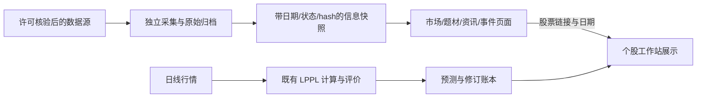
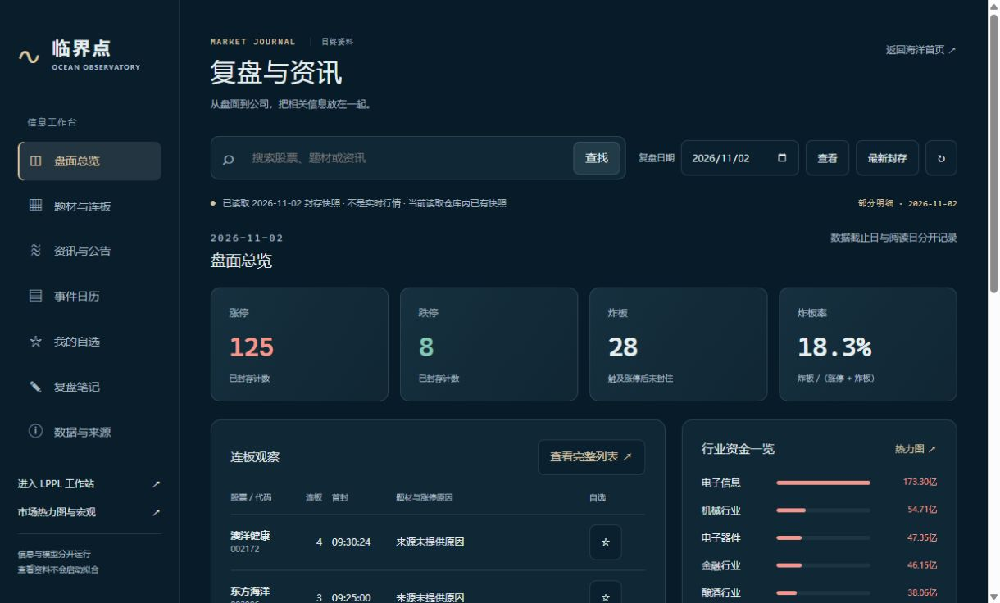

# Vibe AStock 与 LPPL 信息层：固定版本功能比对

记录日期：2026-11-09。此次对象是 **`simonlin1212/vibe-astock`**，不是此前检查的 `Vibe-Research` 或 `TradingAgents-astock`。第 1–8 节只读检查上游源码并比较 LPPL 实现前基线；第 9–11 节记录随后实施的结果、完整功能路线和本地验收。本文不是上线验收报告。

## 1. 结论与检查范围

**VERIFIED（静态实现）**：Vibe AStock 的价值不只是数据接口。它已经把短线复盘、行情观察、资讯、自选、事件和个股研究组织为独立页面，并有分块加载、先读存档再刷新、日期切换和失败保留旧内容等交互。这些正是 LPPL 当前信息层需要补的部分。此前完成的三个离线解析器和证据导入不能等同于已经完成这些用户界面。

**建议**：参考其页面分工、数据到页面的映射和状态处理，在 LPPL 内独立实现信息层；保留现有首页、个股工作站和 LPPL 计算入口。不整包移植它的个人 AI 工作台，不把资讯、题材、资金或预测市场概率加入 LPPL 输入，不据此改变拟合参数、完整周期 1.5、窗口选择、聚类或提醒评分。

| 对象 | 固定版本 / 检查方式 | 边界 |
| --- | --- | --- |
| Vibe AStock | `e0d08d19848b50d22a772729a06287cdff511629`；远端 HEAD 与本地只读 clone 一致 | 阅读 README、LICENSE/NOTICE、路由、主要页面、服务、页面查询和重点复盘计算；没有运行其代码 |
| LPPL | `2c3962f3c55c4ed4b88bf08ecb07bf923a4c8f2d`；按此 commit 读取文件 | 本报告的“当前缺口”固定在此版本，不覆盖本轮随后新增的实现 |
| 网络 / 页面执行 | 本轮没有启动上游、安装其依赖、实时抓取数据或登录服务 | **NOT_INSPECTED**：实时成功率、速度、390px/桌面视觉、可访问性运行验收 |
| 权限 / 模型效果 | 查看代码许可和数据声明 | **NOT_ESTABLISHED**：逐源商业再分发授权、大陆网络稳定性、生产服务能力、任何提前预测收益 |

本文第 1–8 节的 **VERIFIED** 表示所述结构或分支在固定源码中可核对；**作者报告** 表示 README/注释的历史运行结果，未由本轮独立复现；**NOT_ESTABLISHED** 表示现有证据不足；**NOT_INSPECTED** 表示本轮未检查。实施与运行验收证据在第 9–11 节单独列出，不与上游声明混用。

固定入口：[上游 README](https://github.com/simonlin1212/vibe-astock/blob/e0d08d19848b50d22a772729a06287cdff511629/README.md)、[上游路由](https://github.com/simonlin1212/vibe-astock/blob/e0d08d19848b50d22a772729a06287cdff511629/desktop/src/verticals/finance/router.tsx)、[LPPL 基线市场页](https://github.com/CareyPang/LPPL/blob/2c3962f3c55c4ed4b88bf08ecb07bf923a4c8f2d/frontend/market.html)。

## 2. 路由与真实用户功能矩阵

下表“有实现”表示路由、组件或数据调用存在；不代表所有来源在今天可用，更不代表已在本轮浏览器中验收。

| 上游入口 | 源码确认的功能 | LPPL 基线差距与选择 | 证据状态 |
| --- | --- | --- | --- |
| `/` | 总览入口、栏目导航、市场背景 | 首页应继续保留海洋叙事；进入工作站后再进入工具，不需要复制上游首页 | VERIFIED（路由/组件） |
| `/watch` | 自选/持仓、昨日梯队、大票和成交额榜；急拉急跌、封板开板的描述性事件 | LPPL 没有对应完整盯盘页。先做日终信息与股票跳转，盘中权限和存储就绪后再做盯盘 | VERIFIED（页面/服务） |
| `/watch/intraday` | 竞价强弱、六时点情绪路径，昨日涨停群体分板位观察 | 可复用“不补造错过时点”的规则；不是现有 LPPL 日终快照的实时化开关 | VERIFIED（页面/服务） |
| `/shortline`、`/shortline/:tab` | 今日情绪、AI 复盘、AI 周报、近 5 天、情绪历史、明日验证、涨停样本、结构变化八个分页 | LPPL 需要独立的复盘栏目、真实日期选择、涨停原因/题材/晋级展示；AI 总结和打法样本不是本轮优先项 | VERIFIED（八页签及分派） |
| `/daily-review` | 情绪、涨停池、昨日池、强势原因、龙虎榜；涨跌分布、行业资金、成交额榜；指数趋势、两融、估值、国债背景 | LPPL 已有部分情绪、热力图、两融和估值，但还缺组合成可操作的复盘工作流 | VERIFIED（页面查询/组件） |
| `/intel/investment-news` | 产业 RSS 分类、原始标题/链接、存档先显、刷新状态；可选翻译与摘要 | 优先独立资讯页与标题元数据。翻译/摘要需另行核实内容许可和成本 | VERIFIED（页面调用）；来源当前成功率 NOT_INSPECTED |
| `/intel/news`、`/intel/filings` | 自选列表对应个股新闻与 A 股公告汇总 | 这两项有实际 `WatchlistFeed` 和 API 调用；不能因配置 `integrated:false` 误判为未实现 | VERIFIED（组件分支） |
| `/intel/events` | Polymarket / Kalshi 预测市场概率展示 | LPPL 按用户既定条件：取得书面许可后才启用约 6 小时刷新；标来源、时点、流动性和 stale，不称官方 FedWatch，不进入 LPPL | VERIFIED（上游组件）；LPPL 授权 NOT_ESTABLISHED |
| `/signals/:tab` | 实际页面目前只有 GPU 租金分页，有现货、历史、远期及 stale 状态 | 后端虽登记更多产业信号，不能说 UI 已完整展示；LPPL 暂不照搬全部“已注册端点” | VERIFIED（页面仅一个分页） |
| `/sectors`、`/sectors/:key` | 产业板块目录、研究步骤、复制提示词、填入 Agent 草稿 | 主要是研究方法目录，不是已经填满事实/公司的实时题材数据库；不能替代 P1 的题材热度和涨停原因 | VERIFIED（页面/静态数据用途） |
| `/candidates` | 自选/持仓或主要指数成分池，PE/PB/市值/成交额/换手区间筛选，满足/缺数据/不满足分开 | 适合后续独立筛选页；当前成分池不能作为历史 PIT 股票池 | VERIFIED（页面/服务）；历史 PIT NOT_ESTABLISHED |
| `/my-stocks?tab=watch` | 自选增删、导入、排序、报价、选中后 K 线、进入研究 | LPPL 已有浏览器本地自选/最近分析/区间修订，不应再次声称缺少；缺的是市场列表和这些记录的连接 | VERIFIED（两边代码） |
| `/my-stocks?tab=hold` | 持仓/交易账本与表现 | 属于个人投资账本，有额外隐私与多用户隔离要求；不必随资讯层一起引入 | VERIFIED（路由/页面/服务）；计算全面正确性 NOT_INSPECTED |
| `/calendar` | 披露预约、解禁、分红、财报、宏观、用户裁决点/复核日等分类时间线 | 适合独立事件页，再与个股时间轴连接；必须区分预计日期、公告日期、发生日期 | VERIFIED（事件服务/页面） |
| `/research` | 股票选择；概览与深度研究分开；K 线、财报前瞻/复盘、事件回看；深度任务启动/取消/历史报告 | 对应 LPPL 个股页的信息补充区，进入页面不能自动触发长历史回放或 LLM 研究 | VERIFIED（页面/组件） |
| `/journal/:tab` | 交易记录、风险、复盘、模式记录 | 属于另一条产品线；首期不并入，以免偏离顶部时间区间主任务 | VERIFIED（路由/服务）；具体交易统计未全面审计 |
| `/backtest`、`/debate` | 独立回测与多空讨论入口 | 不能替代 LPPL 逐日预测账本或新评价器；本轮未审核其全部回测正确性 | VERIFIED（入口）；核心算法 NOT_INSPECTED |
| `/my-reports`、`/notes`、`/inbox`、`/settings` | 报告库、笔记、收件箱和配置 | 报告/笔记可后续接，但不能引入服务器共用个人凭据的运行方式 | VERIFIED（路由）；全部子操作 NOT_INSPECTED |

旧 `/stock-data`、`/watchlist`、`/portfolio` 有兼容跳转，保留查询参数与 hash。LPPL 信息层改版也应保留 `stock.html?code=...`、首页入口、已有分析链接与证据链接。

## 3. 复盘能力：哪些能学，哪些不能直接当结果

### 3.1 页面不是一个大请求

**VERIFIED**：`Shortline.tsx` 先请求业务日期和情绪头部，再分别加载事实、题材、情绪周期、连板梯队；各块可独立显示加载、缓存、部分成功或失败。切换日期有序列标记，旧请求不能把结果写进新日期页面。页签只加载自己需要的区块。这适合 LPPL 的“行情先显示、背景信息独立刷新、模型计算独立排队”。

证据：[Shortline 页面](https://github.com/simonlin1212/vibe-astock/blob/e0d08d19848b50d22a772729a06287cdff511629/desktop/src/verticals/finance/pages/Shortline.tsx)、[短线页面查询声明](https://github.com/simonlin1212/vibe-astock/blob/e0d08d19848b50d22a772729a06287cdff511629/orchestrator/src/finance/shortline/pages.ts)、[服务分派](https://github.com/simonlin1212/vibe-astock/blob/e0d08d19848b50d22a772729a06287cdff511629/orchestrator/src/finance/shortline/register.ts)。

### 3.2 历史与实时分开

**VERIFIED**：每日复盘由服务端交易日上下文决定默认业务日；页面查询显式区分 `YYYY-MM-DD` 和 `YYYYMMDD`，龙虎榜使用 `trade_date`。涨跌分布、当前板块资金与成交额榜是当前快照源，在回看较早日期时不能冒充那个历史日期。东方财富与新浪备用板块源的分类和净额口径不同，查询声明要求标出差异。

**VERIFIED**：情绪历史统计六项读数：涨停数、最高连板、炸板率、昨日涨停群体收益中位数、跌超 5% 家数、1 进 2 晋级率；不足 10 个样本不给分位。源码保守设定涨停相关源保留期为 28 个日历日，更早只读已有缓存，缺失就缺失。**作者报告**：注释提到 2026-10-10 测过 29 天保留期与一次请求耗时，本轮没有复测，不能当供应商承诺。

**建议**：LPPL 继续用已经建立的 append-only 快照和交易所验证日历；历史选择只读相应封存版本。不得用当前名单、最新题材、当前新闻或最新股东资料拼成过去页面。历史日期匹配和可用时点分别检查：记录所属日期正确，并不自动证明当时已获得这条信息。

证据：[页面查询/当前快照口径](https://github.com/simonlin1212/vibe-astock/blob/e0d08d19848b50d22a772729a06287cdff511629/orchestrator/src/finance/page_queries.ts)、[情绪历史](https://github.com/simonlin1212/vibe-astock/blob/e0d08d19848b50d22a772729a06287cdff511629/orchestrator/src/finance/shortline/history.ts)。

### 3.3 六时点与盘中事件

**VERIFIED**：六时点为 09:25、09:35、10:00、11:30、14:00、15:00；保存当时观察，错过时点不通过事后抓取补造。`intraday.ts` 校验报价日期、采样时间偏移与会话状态，竞价与连续交易需要不同处理。

**VERIFIED**：盯盘持续交易时轮询间隔为 3 秒，竞价/午休等为 15 秒，非活跃阶段为 60 秒；部分大票列表独立降频。急拉急跌用约 3 分钟 1.5% 的固定阈值和冷却期，封板/开板基于报价触及状态。它们是市场事件标签，不是未来顶部概率。页面关闭后页面驱动的轮询停止。

**建议**：LPPL 不复制这一频率作为数据商认可频率。先核实授权、数据延迟、负载与共享缓存，再决定自己的后台采集周期；不能让每位访客独立打上游 3 秒请求。六时点要服务端调度、共享原始归档、错过明确记录，不能依赖访客打开页面才积累历史。

证据：[六时点采样](https://github.com/simonlin1212/vibe-astock/blob/e0d08d19848b50d22a772729a06287cdff511629/orchestrator/src/finance/shortline/intraday.ts)、[盯盘逻辑](https://github.com/simonlin1212/vibe-astock/blob/e0d08d19848b50d22a772729a06287cdff511629/orchestrator/src/finance/shortline/watch.ts)、[后台计划](https://github.com/simonlin1212/vibe-astock/blob/e0d08d19848b50d22a772729a06287cdff511629/orchestrator/src/finance/schedule.ts)。

### 3.4 验证账本、样本统计与预测边界

**VERIFIED**：明日验证模块有事后填写标记；次交易日 09:15 后编辑的条件排除正式评分，未收盘结果为暂定。可参考这种“预先写下、禁止事后当先验”的约束，但上游验证的是市场情绪条件，不是 LPPL 顶部时间区间。

**VERIFIED**：涨停样本模块明确说明：前一日收盘仍涨停的事后群体，含可能买不到的一字板；以前收盘至当日收盘等权描述，没有成交排队、滑点和交易执行模拟。因此不能把“首板/早封/连板”统计称为可实现的策略收益，更不能当顶部预测命中率。

**NOT_ESTABLISHED**：这个仓库能提高 LPPL 顶部提前量、减少阶段顶漏报、改善抄底或预测回撤深度。搜索已读前后端/技能源码未发现 LPPL/LPPLS 集成证据；信息丰富不能替代模型的逐日样本外评价。LPPL 的历史重放、首次本地可用、首次公开可见应继续分开。

证据：[明日验证](https://github.com/simonlin1212/vibe-astock/blob/e0d08d19848b50d22a772729a06287cdff511629/orchestrator/src/finance/shortline/verification.ts)、[样本统计边界](https://github.com/simonlin1212/vibe-astock/blob/e0d08d19848b50d22a772729a06287cdff511629/orchestrator/src/finance/shortline/samples.ts)、[结构变化比较](https://github.com/simonlin1212/vibe-astock/blob/e0d08d19848b50d22a772729a06287cdff511629/orchestrator/src/finance/shortline/structure.ts)。

## 4. 资讯、个股和交互的可借鉴部分

**VERIFIED：资讯页。** RSS 产业分组先给存档、再后台刷新；失败保留原内容并说明 stale。原始标题保留，可选标题翻译和摘要是另一个步骤。自选新闻/公告有独立聚合；概率有独立页签。源码里的 `integrated` 字段描述集成标记，不能代替对实际渲染分支的检查。后端声明中的 Techmeme、RSS、财联社等块，也不能直接推断每个端点均出现在当前 UI。

**VERIFIED：股票概览。** K 线支持日/周/月、A 股前复权/后复权/不复权、成交量和均线；选股、周期或复权改变会重置请求状态，避免旧股票内容闪入新股票。选择股票只打开概览，不自动开始六阶段研究。财报前瞻/复盘与事件回看有独立组件；事件回看描述历史反应，不输出下次目标价。具体跨市场财报换算及事件统计公式未在本轮逐条复算，正确性 **NOT_ESTABLISHED**。

**VERIFIED：自选与筛选。** 上游自选由本地后端账本保存，前端有缓存与排队写入，不只是浏览器 localStorage。候选池区分满足条件、不满足和缺数据；显式指标过滤不等同投资评级。其产业研究页主要给分步提示词，不应误读为已生成、已核实的产业数据库。

**VERIFIED：界面交互。** 布局有可折叠导航、移动抽屉、Escape/焦点管理、暗亮主题、URL 页签和兼容路由；这些是可参考的交互实现。**NOT_INSPECTED**：本轮没有运行它来检查 390px、触屏、键盘、读屏或动效，也不能宣布达到 Awwwards/Webby/FWA 质量。

证据：[资讯页面](https://github.com/simonlin1212/vibe-astock/blob/e0d08d19848b50d22a772729a06287cdff511629/desktop/src/verticals/finance/pages/Intel.tsx)、[存档先显 Hook](https://github.com/simonlin1212/vibe-astock/blob/e0d08d19848b50d22a772729a06287cdff511629/desktop/src/core/data/useArchiveThenRefresh.ts)、[个股页面](https://github.com/simonlin1212/vibe-astock/blob/e0d08d19848b50d22a772729a06287cdff511629/desktop/src/verticals/finance/pages/Research.tsx)、[K 线组件](https://github.com/simonlin1212/vibe-astock/blob/e0d08d19848b50d22a772729a06287cdff511629/desktop/src/verticals/finance/components/KlineCard.tsx)、[财报服务](https://github.com/simonlin1212/vibe-astock/blob/e0d08d19848b50d22a772729a06287cdff511629/orchestrator/src/finance/earnings_brief.ts)、[事件日历](https://github.com/simonlin1212/vibe-astock/blob/e0d08d19848b50d22a772729a06287cdff511629/orchestrator/src/finance/events.ts)、[候选池服务](https://github.com/simonlin1212/vibe-astock/blob/e0d08d19848b50d22a772729a06287cdff511629/orchestrator/src/finance/candidates.ts)、[自选账本客户端](https://github.com/simonlin1212/vibe-astock/blob/e0d08d19848b50d22a772729a06287cdff511629/desktop/src/verticals/finance/lib/watchlist.ts)、[产业目录页面](https://github.com/simonlin1212/vibe-astock/blob/e0d08d19848b50d22a772729a06287cdff511629/desktop/src/verticals/finance/pages/Sectors.tsx)、[布局](https://github.com/simonlin1212/vibe-astock/blob/e0d08d19848b50d22a772729a06287cdff511629/desktop/src/verticals/finance/components/layout/Layout.tsx)。

## 5. 数据源、许可与部署约束

### 5.1 代码开源和数据可发布是两件事

**VERIFIED**：仓库代码许可证为 Apache-2.0，`NOTICE` 保留来自 Vibe Research 底座的 MIT 声明。若实际复制代码，应保存相应许可证、版权与 NOTICE，并记录固定版本和修改范围。此报告只参考设计与源码结构，没有把上游代码复制进 LPPL。

**VERIFIED**：解析注册表可数出 182 个端点；这只能证明注册数量。数据源目录自身明确写明：已登记、合规标签不等于当前可用，也不是商用/再分发权限保证。没有逐一运行全部 182 个端点，不能声称“182 个功能全部可用”。

| 数据家族 | 源码中的主要用途 | 移入公开 LPPL 网站前仍缺什么 |
| --- | --- | --- |
| 东方财富 / 同花顺 | 涨停池、昨日池、原因/题材、资金、龙虎榜、财务/公告、解禁等 | 自动访问与再分发许可、合理频率、字段口径、日期能力、保留期、大陆可达性；原因是来源叙事，不是已证因果 |
| 腾讯 / 新浪等行情及备用源 | 报价、部分行情榜单和备用行业资金 | 延迟、授权、并发和频率、备用源口径不可混合；共享缓存不能抹掉真实来源 |
| RSS / 财联社 / Techmeme 等 | 新闻条目、产业线索 | 逐发布者权利与保存范围；LPPL 按既定政策先保存标题、来源、时间、链接和 hash，不自动转载正文 |
| 交易所/指数机构/官方宏观和其他全球源 | 日历、成分、估值、宏观及跨市场事实 | 每源条款、发布日期/修订、时区、access限制；注册中的官方标签不代替本轮审核 |
| Polymarket / Kalshi | 预测市场隐含概率 | LPPL 要求的书面许可；合约含义、时点、流动性、stale；禁止标成官方 FedWatch 或当 LPPL 因子 |
| AI 供应商 / 本地 CLI | 摘要、翻译、六阶段研究、多空讨论 | 用户同意、凭据隔离、数据传输边界、成本控制与输出核验；基础行情/资讯展示不应以 AI 可用为前提 |

上述未完成事项均为 **NOT_ESTABLISHED**。上游“公开/免鉴权”是访问形态，不是对外商业服务许可。上游代码的轮询常数是本地实现选择，不是供应商频率承诺。

证据：[LICENSE](https://github.com/simonlin1212/vibe-astock/blob/e0d08d19848b50d22a772729a06287cdff511629/LICENSE)、[NOTICE](https://github.com/simonlin1212/vibe-astock/blob/e0d08d19848b50d22a772729a06287cdff511629/NOTICE)、[数据目录说明](https://github.com/simonlin1212/vibe-astock/blob/e0d08d19848b50d22a772729a06287cdff511629/datasources/README.md)、[固定注册表](https://github.com/simonlin1212/vibe-astock/blob/e0d08d19848b50d22a772729a06287cdff511629/datasources/registry.json)。

### 5.2 它首先是个人本地工作台

**VERIFIED**：前端是 React/Vite，后端 Node 服务调度 Python 取数/计算，依赖本地文件与 `.local` 账本/缓存。基础运行要求在 README 中为 Node ≥22.18、Python ≥3.11；默认前端端口 5940、本地 API 8770。取数服务用子进程并有超时、输出量和取消控制。静态 Pages 或普通无持久盘的边缘函数不能原样承担整套服务。

**VERIFIED（文档约束）**：远程模式针对 macOS/Linux，要求 HTTPS 根路径和访问口令，本地 API 仍绑定回环地址；文档明确持有链接者能访问同一电脑上的全部日志和持仓。它是个人工作台的远程访问，不是公开、多租户、按用户隔离的生产后端。

**建议**：腾讯云方案需独立拆出共享采集、任务队列、不可变证据存储、面向访客的只读 API 和账户私有记录。模型任务与资讯采集分开资源预算；服务器持有数据源凭据，浏览器不能包含服务密钥。仅复用页面思路无需引入上游整套 AI/CLI 依赖。本轮没有购买、部署、发布或配置远程访问。

证据：[README 安装/远程/限制](https://github.com/simonlin1212/vibe-astock/blob/e0d08d19848b50d22a772729a06287cdff511629/README.md)、[取数与任务服务](https://github.com/simonlin1212/vibe-astock/blob/e0d08d19848b50d22a772729a06287cdff511629/orchestrator/src/service.ts)。README 中的完整研究成功例、测试数量、打包/实机可用性均属于 **作者报告**；本轮没有复跑。

## 6. LPPL 基线为什么还不像完整复盘软件

以下均为 **VERIFIED（`2c3962f` 静态源码）**：

1. `frontend/market.html` 的“题材库 / 资讯雷达 / 全球宏观”只滚动到功能接入地图，没有对应的功能页面。历史复盘按钮携带 `replay` 标记，但复盘页签只有 `overview/direction/reason`，还没有真正的历史专页。
2. 涨停原因视图写死 `NOT_ESTABLISHED` 卡片，概览写死“尚无前一日/次日配对”。即使数据侧新增理由、主题或晋级证据，页面仍未消费这些字段。
3. 连板天梯使用 `limit_pools.top20.zt`，显示的是前 20 项子集，不是完整股票池；卡片没有逐股进入工作站的链接，不能宣称完整天梯。
4. 已有行业/概念/地域与今日/5 日/10 日热力图、涨停情绪、北向、两融和指数估值；这些不应重做成另一份来源不明的假数据页面。
5. `market-context-client.js` 已有显式启用、业务日期校验、缺历史不退回最新、失败保留相同日期缓存的基础。默认轮询设为 5 分钟，但客户端代码存在不表示生产后端已经启用或每日采集已经运行。
6. P0 自选、最近分析、区间修订日志已经有浏览器本地实现；需要做的是与信息层的股票链接、筛选、详情关联，而不是宣布“从零补自选”。
7. 前轮资金历史、龙虎榜、解禁三个解析器和证据导入是离线数据层能力，没有自动 live fetch、没有获得数据授权，也没有被市场页渲染。首次本地记录时间不是公开用户第一次看到预测的时间。
8. 基线没有 `frontend/app/market.js`；市场渲染仍内联于 `market.html`。新增独立信息模块时应按实际文件结构接线，不能对不存在的模块声称完成改造。

证据：[市场页](https://github.com/CareyPang/LPPL/blob/2c3962f3c55c4ed4b88bf08ecb07bf923a4c8f2d/frontend/market.html)、[历史客户端](https://github.com/CareyPang/LPPL/blob/2c3962f3c55c4ed4b88bf08ecb07bf923a4c8f2d/frontend/app/market-context-client.js)、[P0 账本](https://github.com/CareyPang/LPPL/blob/2c3962f3c55c4ed4b88bf08ecb07bf923a4c8f2d/frontend/app/workstation-ledger.js)、[前轮数据层范围](https://github.com/CareyPang/LPPL/blob/2c3962f3c55c4ed4b88bf08ecb07bf923a4c8f2d/docs/product/upstream-adapter-provenance-2026-11-09.md)。

## 7. 建议的独立信息层及实施顺序

这是设计建议；各项完成与否应由后续实现和验收报告单独记录。

**第一步：把已有数据变成能用的界面。** 市场页有明确的“盘面 / 题材 / 龙虎榜与资金 / 资讯与事件”入口，支持链接直达、后退和保留日期。盘面显示数据日、来源、封存时间、状态和缺口；现有热力图继续可用。天梯/题材/龙虎榜中的股票均能进入 `stock.html?code=...`，回到市场仍保留刚才日期和筛选。

**第二步：按证据显示题材和复盘。** 原因保留来源原文与来源链接；题材有样本数、成员、统计口径、日期；行业与概念不混称。晋级率必须有昨日集合、今日结果、可判定分母、缺失数、未收盘标记。资金分位只有在足够多同口径历史观察存在时才显示，不能拿当前榜单排行当历史分位。

**第三步：做独立信息入口。** 龙虎榜/资金/解禁只消费已验证的 supplemental evidence，保留数据类型与单位。新闻先展示获准的标题元数据，公告与预计事件分开；没有授权或没有快照时显示原因和可用来源链接，不摆一屏无动作按钮，也不制造样例为实时数据。基础资料/F10、财务和股东应另建契约，不能把解禁列表冒充完整 F10。

**第四步：授权后再做后台更新。** 共享服务按交易日调度，记录成功与失败；前端轮询自己的只读接口，读最近封存结果并显示刷新中，避免每个用户直打上游。历史页面不轮询替换为当日。六时点、宏观、概率按各自来源政策启用，概率仍需用户要求的书面许可。

**第五步：补跨页面时间轴。** 在个股页旁边放公告、解禁、宏观事件与市场背景，并与 LPPL 观察/正式提醒/修订/新提醒账本时间轴对齐。视觉上标“背景信息”和“模型输出”；两条数据链只在展示层相遇。解释“为什么还只是观察”应来自模型既有规则和证据，不由新闻标题推断。

图中没有从信息快照到 LPPL 计算的边。后续如研究新因子，必须作为独立研究假设、新版本、样本外实验和明确授权的项目，不在此次 UI 整合中悄悄增加。

## 8. 接入验收清单

- [ ] **页面可达**：每个可点击入口打开真实视图；空态解释数据/授权缺口，不假装功能已在线。浏览器后退、书签、查询参数和现有个股链接正常。
- [ ] **日期可信**：页面日期、数据日、抓取时点、首次本地可用、封存时间分别存储/标明。旧日期没有封存时明确缺失；不回退成最新，不用最新题材补旧原因。
- [ ] **来源可查**：来源、链接、hash、parser/schema 版本、字段单位、来源状态与 stale 原因可追查；备用源不混用主源许可或统计口径。
- [ ] **统计完整**：天梯明确全量或截断；晋级分子/分母和未知样本可见；缺值不是零；历史分位有同口径样本数和覆盖范围。
- [ ] **异步不挡操作**：先显示存档/行情，刷新局部进行；失败保留同日旧内容；切日/切股后旧请求不能覆盖新页面；模型和历史回放不被资讯刷新触发。
- [ ] **股票联动**：市场列表、主题成员、龙虎榜、新闻和事件可到对应股票；进入个股后行情与已有分析先显示，自选/最近/修订记录兼容。
- [ ] **桌面与 390px**：导航不溢出，表格可合理横向滚动或卡片化，触控与键盘均能操作，焦点可见，状态不仅靠颜色；减少动效设置有效。
- [ ] **安全与权限**：外部链接协议限制，标题/原因按文本渲染，新闻不执行 HTML；新源无授权不启动 live fetch/公开再分发；凭据不进前端包；用户私有记录不与公共快照混存。
- [ ] **隔离回归**：不改 LPPL 参数、周期过滤、窗口/聚类、顶部/底部评分、历史重放标签或首次公开可见账本；背景信息不产生新模型提醒。
- [ ] **发布边界**：代码/离线样例/UI 验收可更新 PR；真实外部采集、部署、购买、发布和合并分别按已有授权边界执行。没有运行的验收不能标完成。

本报告完成的是固定版本的源码功能比对与接入设计。**NOT_INSPECTED** 的实时端点、实际浏览器体验和部署行为，以及 **NOT_ESTABLISHED** 的数据许可、PIT 和预测能力，均保留为明确未完成项。

## 9. 本轮实际实施

本节 **VERIFIED** 限于本地代码、自动化测试和指定浏览器验收；没有将数据源或网站上线。

### 9.1 页面和操作

新增 `frontend/review.html`，从原市场页“题材库 / 资讯雷达 / 事件日历”和个股页“复盘与资讯”进入。继续使用海洋深蓝、象牙白和香槟色，涨跌红绿只表达行情；侧栏用于工具，首页保留原海洋叙事。桌面为侧栏和分栏内容，手机为横向导航、双列指标和全屏个股资料。

| 页面 | 本轮可操作内容 | 数据可用性边界 |
| --- | --- | --- |
| 盘面总览 | 涨停/跌停/炸板及炸板率、股票列表、行业资金、资料状态 | 仓库现有真实快照为 2026-11-02；明确显示封存日、不是实时行情；20/125 明细不称全量 |
| 题材与连板 | 题材成员过滤、来源原因、按板位分组、同日完整池优先、行业/概念/地域 × 当日/5日/10日 | 新字段按契约消费；当前静态旧快照缺题材和晋级，显示缺失，未填假值 |
| 资讯与公告 | 新闻/公告/研报分类、文本与来源搜索、原文链接、收藏筛选 | 只接获准标题索引；当前无已接通的真实公开资讯 feed，页面不伪造文章 |
| 事件日历 | 按事件日排序、已知时间、来源取得时间、原始链接、关联股票 | 未来事件仅为已知计划；没有数据时解释缺口 |
| 个股资料弹层 | 从列表或六位代码打开；独立读取已有日 K 线和成交量；逐日 OHLC/量；加入自选；明确点击才进入 LPPL 工作站 | 行情来自既有 LPPL.stock.market；未配置 API 时资料、自选仍可用；历史日期不以最新行情/公司资料代替 |
| 公司资料分节 | 概况、财务、股东、龙虎榜、资金、解禁、公告/新闻/研报/事件 | 已有对应字段展示和来源/日期/状态；不是已上线的完整 F10 服务，真实源仍待接通 |
| 我的自选 | 共用现有 P0 自选、最近查看及分析记录 | 仅当前浏览器；查看资讯不会覆盖已有分析日期、证据状态和修订账本；无账户同步 |
| 复盘笔记 | 按日期记笔记、原文收藏、JSON 导出；未保存草稿在刷新和切页时保留 | 本机个人记录，固定 `user_note_not_model_evidence`；存储失败明确显示仅内存；不是预测发布凭证 |
| 日期与来源 | 明确日期读取、无历史不回退最新、同日失败缓存、乱序响应隔离、来源与 hash | 最新视图在后端显式启用时才每 5 分钟读取；历史不轮询；没有启用生产更新任务 |

顶部信息页面不创建分析任务，不调用 `LPPL.stock.request`，不启动 104 周回放。股票资料通过已有数据入口读取，未修改受保护的 `frontend/app/lppl-data.js`。本轮不复制上游源代码、不安装上游运行依赖，以独立实现借鉴其产品分工。

### 9.2 后端与证据

新增 `investor-context.v1` 聚合器及腾讯只读兼容接口，13 个独立栏目详见 [接口契约](../deployment/investor-context-contract.md)。`/investor-context` 按日期和资产读已存对象；`/context` 和 `/market` 投影相应信息，缺资讯不触发抓取或计算。新增 store 为内存契约实现，**不是生产数据库或自动采集服务**。

公开读取检查日期、资产、hash、用途和逐来源许可记录；研究导入、fixture 或显式不允许发布的内容无法仅修改顶层布尔值来展示。没有来源许可记录的节被阻断。许可字段是外部审核记录，不能据此宣称真实供应商已经授权。新闻只保留标题、来源、发布时间、链接、资产和内容 hash，不保存正文。

当前公司简介禁止回填旧日；其余后来取得的回溯资料带 `retrieved_after_asof`。资讯页显示知识截止，个股资料显示来源取得时间及回溯说明。**历史资料日不等于当时已知，也不等于模型首次公开可见。** 仍不认证 PIT。

同时将腾讯 market-context seed 的研究导入、补充源及交易所日历门禁与既有 Worker 边界对齐。没有执行 seed，没有改线上快照。

## 10. 完整信息产品路线：补什么、什么时候算完成

下表是按依赖排定的功能方案。未完成项为 **NOT_ESTABLISHED（交付/运行未成立）**，不把本轮页面或契约当作实时服务。

| 顺序 | 用户任务及功能 | 数据和更新方式 | 完成条件 |
| --- | --- | --- | --- |
| A：日终复盘闭环 | 每天先看市场、题材、原因、天梯、昨日晋级、行业资金；按日期回看 | 已验证交易所日历；日终后台共享采集；原始响应和规范化快照 append-only；同日修订另存版本 | 连续多个交易日成功封存；晋级的昨日/今日完整集合、分母、分子可点查；失败和节假日不伪造零值 |
| B：个股信息闭环 | 从任一股票进入 K 线/量、公告、新闻、财务、股东、解禁、龙虎榜和资金历史 | 优先已有 a-stock-data / Vibe 数据目录中的源；逐源验证许可、字段、速率和大陆路径后接适配器；抓取服务和页面读取分开 | 每一栏目至少一组真实成功、空结果、失败与 stale 记录；带来源/日期/单位；支持六位代码和经核验的名称目录；不由用户一次查看触发全量爬取 |
| C：复盘时间轴 | 以股票为主线，把价格、公告、解禁、市场背景和 LPPL 观察/正式提醒/修订/新提醒并排回放 | 使用真实 `published_at/known_at/available_at/first_visible_at`，不同账本只在展示层关联 | 可切“当时已知”与“事后补充”视图；无当时证据则留缺口；不得用新闻重新生成或加分模型提醒 |
| D：资讯中心 | 全市场/自选新闻与公告聚合；来源筛选、行业/题材标签、收藏、去重、搜索 | 只保存获准标题索引；统一共享缓存；按源限频和退避；标题关联只表示提及，不代表因果或利好利空评级 | 多源重复可识别；来源跳转有效；按发布日期与取得日期分开查询；付费正文、转载与 AI 摘要各自另审许可 |
| E：候选筛选与复盘库 | 以行业/市值/估值/成交额等已授权字段过滤；保存个人清单、复核事项、笔记模板 | 当前截面筛选与历史成分池隔离；私有记录与公共信息分库；先本机后账户 | 缺数据明确标记，不能当不符合；历史名单需真实 PIT 才能用于回测；无账户授权前不上传个人持仓 |
| F：盘中观察 | 六时点快照、竞价/开盘/午后状态、封板开板事件、昨日梯队表现 | 先满足实时行情许可和运行预算；按交易所会话调度；错过时点记 missing，不事后补录 | 六时点均保留采样与源时点；累计失败可见；不把上游 3 秒轮询直接当 LPPL 服务承诺；不占用拟合计算队列 |
| G：全球宏观与概率 | Treasury/NY Fed/BIS/ECB/BLS/EIA；授权后补 VIX、DXY、金油汇率；央行日历和新闻 | 各源独立许可/频率/stale 策略；预测市场取得书面许可后约 6 小时刷新 | 每卡来源、时点、修订、stale；Polymarket/Kalshi 明确“预测市场隐含概率”、流动性；不是官方 FedWatch，不进入 LPPL |
| H：面向普通投资者的运营能力 | 账户同步、个人通知偏好、历史导出、可访问性、服务状态和费用控制 | 腾讯后端多用户隔离、数据库/对象存储、任务队列、备份、日志和监控 | 共享采集与用户读请求分离；缓存命中/数据延迟/错误率有实测；安全审计和恢复演练通过后再发布 |

### 分层交互与性能预算

- 页面第一屏只等已有市场快照；个股行情独立返回；新闻、财务等栏目单独失败，不阻塞 K 线。
- “最新封存”和“实时”是不同状态。读取接口的每 5 分钟轮询不代表数据源每 5 分钟更新；后台是否调度、最近成功日必须另行展示与验收。
- 产品目标建议：有缓存时首批可读内容 1–2 秒；无缓存立即显示可操作页面和各区块进度。该数值是待大陆实测的目标，**不是本轮测得 SLA**。
- 局部刷新保留滚动、筛选、当前日期和笔记草稿；异步旧响应不得覆盖新股票/新日期；同日旧数据可保留并解释 stale，跨日不偷换。
- 手机保留关键指标和股票操作，长表在容器内滚动；每个状态同时提供文字，不只依靠红绿；键盘焦点可见，减少动效有效。
- 信息层不新增“准确率/强弱分数/影响分/买卖建议”。LPPL 是否有实用价值继续由原有逐日记录、两级顶部标签和提前量评价验证，不在此信息产品中重新定义成功。

### 不随本轮引入

不接上游完整 AI 交易 Agent、自动买卖、持仓建议生成、LLM 批量深度研究或自动回测流水线。其独立价值、成本和权限需要另行论证；不能仅因上游有入口就加入普通用户主流程。

## 11. 本地验收与未完成边界

**VERIFIED（本地运行）：**

- Python 非网络测试：**683 通过、2 跳过、3 排除**；Ruff `research/tests/server/tencent` 通过。未执行独立模型重跑或外部采集脚本。
- 新信息前端测试 **32 通过**：部分池不能冒充完整、日期/资产/发布资格、新闻链接安全、乱序/超时/同日缓存、笔记与模型证据隔离、存储失败。
- 全部前端与 Worker 契约测试 **254 通过**。
- 桌面浏览器：盘面、题材列表、新闻缺失状态、个股弹层、自选共享、笔记保存及刷新保留草稿、历史缺失不回退、浏览器返回已验收。
- 390×844 viewport：指标双列、横向导航、表格容器、个股全屏弹层；修复表格撑宽页面。浏览器保留 15px 滚动条时 `clientWidth=scrollWidth=375`，页面没有横向溢出。
- 本地临时只读行情适配器读取既有 `2026-11-06` 茅台真实缓存：验证 K 线与成交量、逐日 OHLC/量，明确显示旧行情及成交量单位尚未核验。没有重新获取行情，没有运行拟合，没有新增公开 API。
- 浏览器控制台本次验收未捕获 error；本地预览只用于验收，未部署到云。

验收截图保存在本轮证据目录：桌面首屏、390px 首屏、茅台 K 线与成交量。快照、原始行情与模型旧结果均未覆盖。

桌面首屏使用 2026-11-02 旧封存；不是今日实时数据：

[390px 首屏](assets/investor-context-20261109/review-mobile.png) · [茅台旧缓存 K 线与成交量验收](assets/investor-context-20261109/review-moutai-candles.png)

**NOT_ESTABLISHED：**实时新闻/公告/F10源、每日采集生产运行、腾讯生产持久化、账户同步、完整市场天梯、盘中六时点、严格 PIT、预测性能，以及 P2/P3 上线。信息契约与页面存在不能当作这些能力已上线。

**NOT_INSPECTED：**上游完整浏览器体验、全部上游 API 实时可用性、第三方付费/受限内容、真实大陆多网络延迟及高并发性能。

本轮只更新 PR #50；不合并、不购买、不部署、不发布、不在线 seed。下一项优先完成 A/B 的逐源真实数据验收和可靠封存，再逐步开放对应栏目，避免新增只有名称没有内容的入口。
