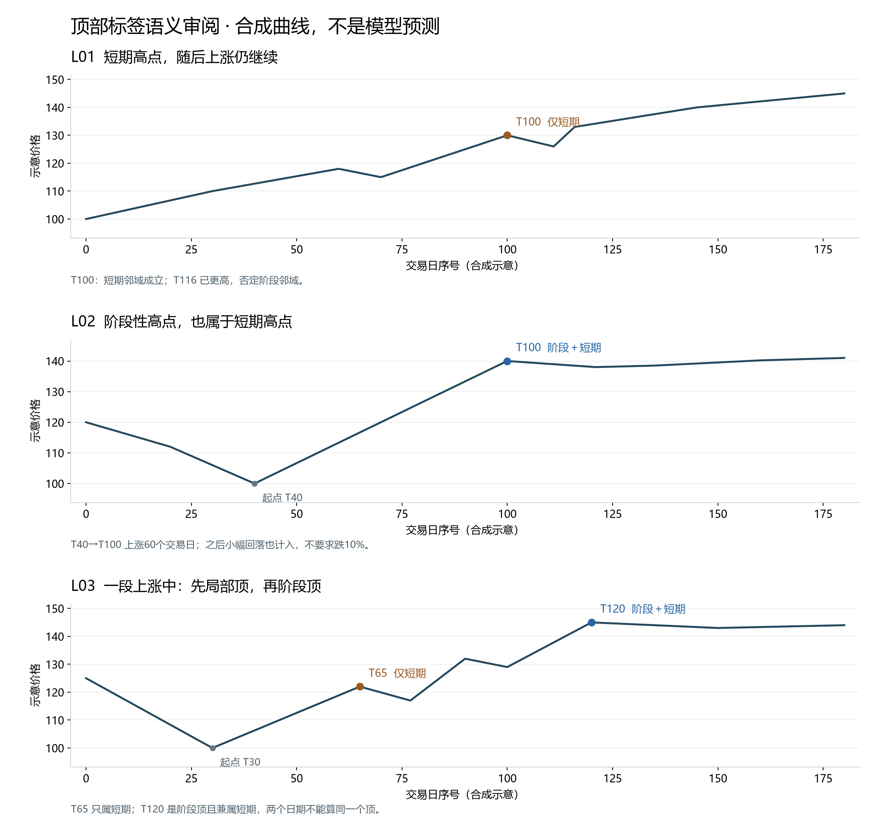
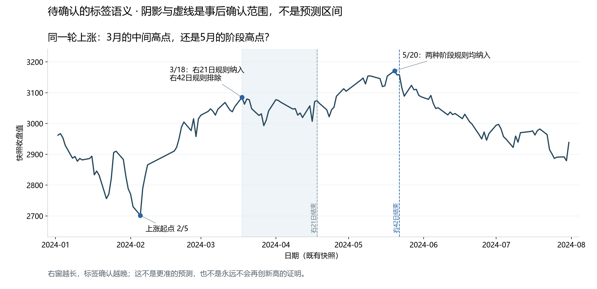
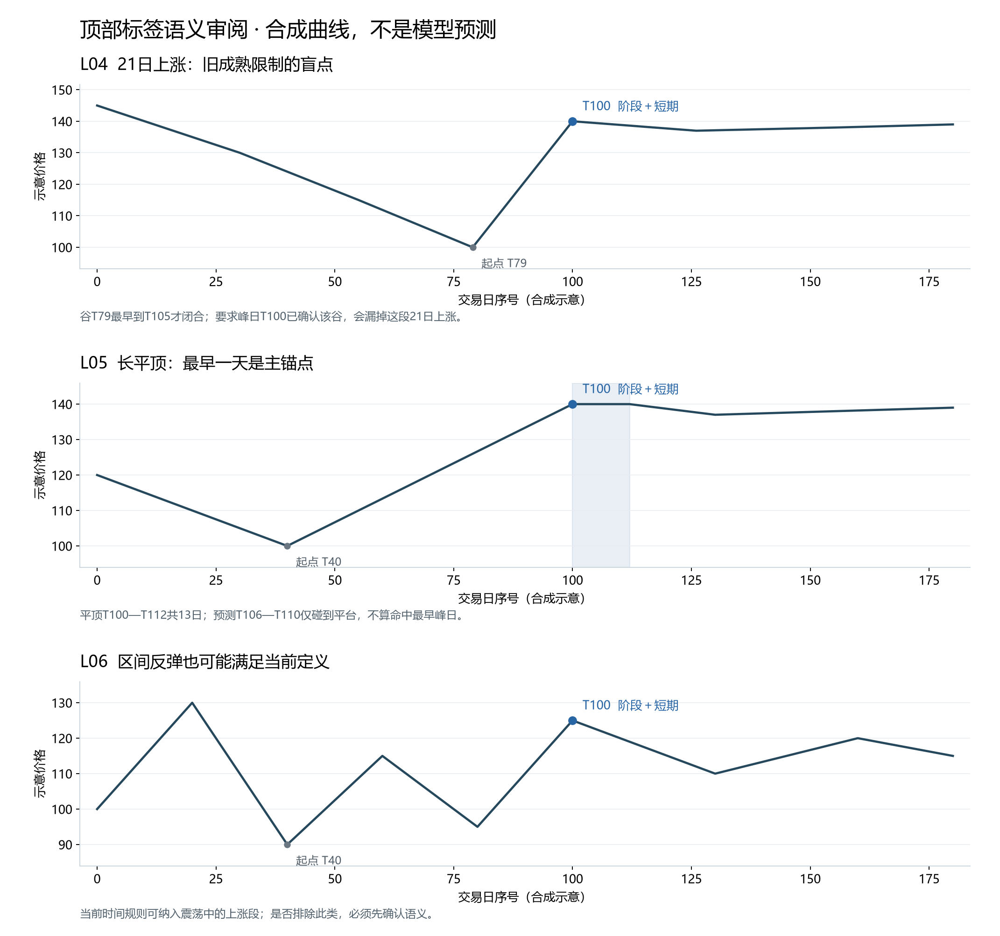

# 顶部标签例集：先确认什么算阶段高点，再评价预测

日期：2026-11-06（Asia/Singapore）。状态：**REVIEW_DRAFT / 两级提醒语义已确认、数值合同待冻结 / 新评价器未实现**。

**最新用户确认：**上证2024-05-20应作为阶段顶重点提醒；2024-03-18事后不属于该阶段顶，但事前若有局部高点预警也要提醒。产品必须保留两级提醒，不因后来出现更高阶段顶而删除较早局部提醒。“后来有一部分回落”说明局部提醒仍有需求，不是新增最低跌幅条件。该答复确认产品含义，没有自动冻结右42日、收盘/盘中高点口径或全窗口5日规则。

例集包含6个合成语义例、7个既有行情案例，以及可复核图表和价格片段；评分文档已从21例补至24例。只做标签含义和评分算术核对；没有读取LPPL拟合/预测文件，没有运行新模型、预测回测、参数优选或生产任务。旧结果保持原身份。

**VERIFIED**只表示本轮可复核的文件、数值、集合关系或作图检查。真实提前预测、现有模型的层级识别能力均为**NOT_ESTABLISHED**。真实行情例来自仓库冻结快照，价格口径及交易日历尚有下述证据边界，不宣称是正式真值数据集。

## 1. 最重要的发现

1. **当前定义的阶段顶必然也满足短期顶条件。** 短期邻域是阶段邻域的子集。可以分别展示“只有短期”和“阶段性（兼属短期）”，但不应该强造三个互斥的自然类别。模型多尺度拟合集中是另一回事，不是标签重合的定义。
2. **原阶段右窗21日可能把上涨过程中的中间高点也叫阶段顶。** 上证2024-03-18和2024-05-20都满足原阶段结构；若希望重点提醒后者，需要先改清楚阶段语义。不能把原63/21参数直接当用户需求已验收。
3. **原起涨谷点“在峰日已经成熟”的约束漏掉21–25日上涨段。** 合成L04与上证2024-03-18均展示该问题。推荐仅对事后标签选择固定峰前范围内的谷，并隔离所有未来依赖；不能把这个谷当成当时已知特征。
4. **不引入跌幅门槛。** 小幅回落仍可能有顶部标签；后来大跌但时间窗错了仍是预测失败。价格层另行研究。

两级提醒的产品含义已按上述答复确认；实现这些含义的数值定义和评分细节仍是**待确认的规则建议**。本轮不将其覆盖写入旧协议、不生成新模型成绩；原协议顶端已指向本次审阅材料。

## 2. 本例集如何标注

| 项目 | 用于审阅的候选 | 当前状态 |
|---|---|---|
| 价格目标 | 日线收盘高点；不用盘中high替代 | 待用户确认；现有快照为qfq，正式公司行动口径另核验 |
| 短期结构 | 左10、右10个交易日的最高收盘值 | 草案，不表示最佳窗口 |
| 原阶段结构 | 左63、右21个交易日的最高收盘值 | 原草案，作为对照 |
| 更长阶段确认 | 左63、右42个交易日的最高收盘值 | 本轮语义对照，未通过模型评分选择 |
| 上涨段 | 峰前固定21–126交易日范围中，最近合格21/21谷；峰高于谷、期间没有低于该谷 | 推荐采用事后确认版本；21–126只是约1–6个月的交易日近似 |
| 同价分组 | 精确同价、相邻候选差≤5日才合并；最早日为主锚点 | 不用百分比或波动率容差合并近价 |
| 成熟 | 峰、谷、平台合并和不存在更晚谷的全部依赖均可得 | 尚未成熟为待定，不算误报/成功 |

真实案例的“交易日数”在本轮计算中实际为**共同观测日期序列的索引差**。两份文件日期相同不能独立证明交易所日历完整，因此正文数字明确称“观测间隔”；正式实现前需要交易所日历和停牌处理。

63日左窗不保证峰前整段上涨恰好63日；上涨段还需单独查起点。42日右窗不保证周期永久结束，也不是提前42日预测。标签确认需要未来数据，真实预测仍必须只读当时可得信息。

## 3. 先看三个最直观的合成案例

以下为手工构造价格，不是资产行情或拟合输出。图中只标指定审阅点，不声称标出了整条曲线的所有事件。



| 合成例 | 指定高点 | 短期标签 | 原阶段标签 | 要确认的意思 |
|---|---|---|---|---|
| L01 | T100 | 是 | 否 | 数周局部顶；T116出现更高值，仍在阶段右窗内 |
| L02 | T100 | 是 | 是 | T40到T100上涨60日；阶段顶自然兼属短期，后续无须跌10% |
| L03 | T65、T120 | 两者都是短期 | T65否、T120是 | 同一上涨段里可以先出现局部顶，后出现主要阶段顶；两日期不是同一事件的“双命中” |

产品上可将L02/L03后一个高点写成“阶段性顶部候选”，并在依据中说明兼属短期。不能把“两个标签重合”直接变成更高的预测概率。

## 4. 真实行情例：标签核对，不是预测命中

来源为`data/frozen/v20261104/sh000001_qfq.parquet`与`sh600519_qfq.parquet`，文件身份见证据包。案例选择先看指定日期和价格结构，不读取模型输出，也不按后续跌幅挑选。

| 标的/峰日 | 快照收盘值 | 原短期10/10 | 原阶段63/21＋事后上涨段 | 起涨谷→峰的观测间隔 | 若阶段右窗改42日 |
|---|---:|---|---|---|---|
| 上证 2023-04-18 | 3393.33 | 是 | 否 | 谷2022-12-23；75，但阶段结构不成立 | 仍不成立 |
| 上证 2023-05-08 | 3395.00 | 是 | 是，兼属短期 | 2022-12-23→峰；86 | 仍成立 |
| 上证 2024-03-18 | 3084.93 | 是 | 新事后谷规则成立；旧峰日成熟规则失败 | 2024-02-05→峰；24 | 不成立，范围内有5/20更高值 |
| 上证 2024-05-20 | 3171.15 | 是 | 是，兼属短期 | 2024-02-05→峰；64 | 仍成立 |
| 贵州茅台 2023-07-28 | 1704.20 | 是 | 是，兼属短期 | 2023-05-31→峰；40 | 仍成立 |
| 贵州茅台 2024-04-01 | 1564.23 | 是 | 否 | 谷2024-01-17；47，但阶段结构不成立 | 仍不成立 |
| 贵州茅台 2024-05-07 | 1608.46 | 是 | 是，兼属短期 | 2024-01-17→峰；68 | 仍成立 |

上表数值是**VERIFIED（指定冻结快照条件下）**。茅台为该文件的前复权值，不是未经调整的当年市场报价。它们没有对应的已核验原始预测时间戳，本轮不计算“预测了7例中的几例”。

### 4.1 上证2023-04-18与05-08：差一点价格，也不能偷改标签

4月18日的3393.33在前后10个观测日内最高。但5月8日为3395.00，位于其右侧第11个观测间隔，进入阶段右21日而不进入短期右10日。因此4月18日是短期例，5月8日是阶段例。差值仅1.67点仍是更高；若用“差不多一样高”并顶，等于偷偷引入幅度容差。

这也是仅用单日最高点标签的局限：一段接近同价的顶区可能被拆成不同事件。是否未来另立“顶部区域”目标可讨论，但不能为了命中方便，在当前日期标签中临时合并。

### 4.2 上证2024-03-18与05-20：已确认的提醒层级



- 原右21日：3月18日之后观察到4月18日，没有更高收盘值，故3月18日可成为阶段结构标签；它也有从2月5日起24个观测间隔的上涨段。
- 右42日候选：确认范围到5月22日，包含5月20日更高收盘值，故排除3月18日的阶段标签；其短期标签仍保留。
- 5月20日：两种右窗下均为阶段结构，起点仍为2月5日，间隔64。

**VERIFIED（用户确认的产品语义）：3月18日作为局部/中间高点，有事前预警也要提醒；5月20日作为阶段高点重点提醒。** 因此可继续把右42日作为阶段标签候选，保留右21日对照；42日尚未冻结，也不是“42日预测更准确”的研究结论。两级提醒并存，阶段条件未达到不能成为隐藏局部预警的理由。

更长右窗会减少被纳入的中间高点，并推迟标签成熟；这两个变化都要公布。在孤立峰且无其他分组延长的情况下，5月20日的右21日＋G5依赖结束于6月26日，右42日＋G5结束于7月25日。它们是事后检查依赖的日期，不是可事后冒充的报警日期。

不能只用这一个例子就宣称42日是唯一正确尺度。正式冻结前还需按固定挑选规则扩充慢涨、多次再创新高、震荡反弹等语义例；扩充不查看预测命中率。当前目标已不是把3月18日与5月20日都叫阶段顶，而是保留前者局部提醒并提高后者提醒层级。

实盘时只能依据当时可得信息发布“局部顶部候选”“阶段性顶部候选”或“尺度待判”，不能调用后来才确定的真值来提前分级。如果3月18日被提前误报为阶段顶，时间项可能覆盖局部高点，但阶段误升级仍要记录；不能因为它后来确有回落就免除错级。

### 4.3 21–25日上涨为什么会被旧规则排除

2月5日谷的右21日与G5闭合检查到3月20日才结束，晚于3月18日峰。旧规则要求谷在峰日已经成熟，于是不能选它；退选的2023-10-23谷又被后来更低值击穿，最终漏掉该上涨段。

建议将**事后真值**和**实时可知信息**分开：事后可以确认2月5日起涨，但在任何早于完整成熟时点的训练或预测输入中不得使用这个最终标签。不能为解决遗漏而把未来谷标签提前喂给模型。

此案例同时展示两个独立问题：修复谷成熟限制会使其具备上涨段语义；延长阶段右窗又可能因后来更高峰排除它。两项不能相互掩盖。

### 4.4 个股例与未检事项

茅台2024-04-01的短期结构成立，但阶段右侧第21个观测间隔2024-05-07出现更高值1608.46，阶段不成立。5月7日则在原/较长阶段右窗下均成立，前面从1月17日谷起有68个观测间隔。

本轮没有验证分红除权的完整历史及当时可得复权因子；所以这些是**价格快照下的语义样例**。未来不能直接用当前前复权文件冒充逐日当时可知数据。公司行动为**NOT_INSPECTED**，历史可得时刻为**NOT_ESTABLISHED**。

完整四幅行情图见[真实案例图](evidence/top-time-label-review-20261106/real_examples.png)；七例的左右窗口、谷、闭合日期与旧/新差异见[逐例证据](evidence/top-time-label-review-20261106/selected_real_cases.json)。

## 5. 边界例与不能隐去的缺陷



| 合成例 | 应得结果/争议 | 不允许的处理 |
|---|---|---|
| L04 21日上涨 | 原谷成熟要求排除；事后确认候选可纳入 | 不改数据、不假装峰时已知谷；保留两规则差异 |
| L05 13日平顶 | 事件最早日T100；原短期闭合至T127、原阶段至T138 | 不能用只覆盖T106–T110的窄区间当主命中，也不能裁短平顶 |
| L06 区间反弹 | 原规则仍会纳入T100，较长右窗也未必排除 | 不把“看起来不够像泡沫”当事后删除理由 |

L06说明：固定时间极值＋净向上谷峰段不是“平滑持续牛市”的完整数学表达。若用户只想要连贯趋势的最终高点，需要另定义趋势/阶段终止规则，并在标签审阅时明确；不能等预测失败后再排除震荡。**当前建议接受具有1–6个月上涨段的阶段尺度高点，不保证整轮行情永久结束。**

另有两种账本状态需要单列：

- 在T100潜在峰后只看到T110：短期和阶段都尚未完整闭合，不是“已确认没有阶段顶”。
- 已确认短期、但阶段右窗未到：标签应为`short=true, stage=unknown`，不能暂记short_only后又把错误升级率算得好看。

## 6. 评分规则：以阶段性顶部为主

完整24例见[评分审阅真值表](2026-11-06-top-time-scoring-review.md)，新增局部预警升级为阶段预警的独立时钟示例。以下是核心合同：

```text
阶段主成功 = 首条原始区间包含该阶段事件的最早峰日
          且 含两端区间宽度 <= 10交易日
          且 实际可行动日到峰日 >= 5交易日
          且 在发布时明确提出阶段层级主张
          且 满足已冻结的未来域、匹配、成熟和时序证据要求。
```

原草案额外要求整个区间的最早日也至少距行动日5日，这比仅要求实际峰提前5日更严格，仍需确认。例：行动T95、峰T100、区间T99–T108，峰日提前5日但区间最早日只提前4日；前一种严格合同失败，后一种合同成功。

主成绩同时显示：阶段事件召回、阶段主张精确率、短期独立成绩、误升级/漏识别、提前量、宽度、拒判、每资产提醒负担及按时运行覆盖。不用一个笼统“准确率”替代这些不同问题。

同一目标范围内首次错窗后修中、先宽后窄、取消重发、迟到补算不能修复首次成绩；同一个事件只得一次主要成功。局部预警后首次提出阶段主张，拟单独记录阶段首次可见/可行动时间；阶段提前量不能借用较早局部预警，已发出的错误阶段首窗也不能被升级名义重置。该计分修正仍待确认。阶段与短期兼属同一个事件时，不能对用户宣称命中两次；独立的更早短期高点仍可能漏报。

后续跌幅不参与上述任何成功条件。时间正确但只轻微回落，可以是时间成功；后来跌得深但时间错，仍是时间失败。交易收益、仓位与抄底属于另外的评价合同。

## 7. 本轮实际验证了什么

**VERIFIED：**

- 6条合成曲线、7个指定峰点的邻域关系；合成数组和图表已保存。
- 两份行情文件身份；限定审阅段各529行且共同日期序列一致，无重复日期、缺失/非有限收盘值或非正成交量。
- 7个行情案例的条件标签与左右窗；其中4例再次独立核对并作图；7例右21/42日对照。
- 事后未来依赖与实时预测的区别、严格嵌套关系和手工评分算术。
- 图表渲染检查；生成器只处理显式指定点，不提供通用峰搜索、预测评分或模型执行接口。

**NOT_ESTABLISHED：**真正预测能力、该尺度是否最符合所有用户情形、概率校准、漏报是否改善、真实行动性、历史发布时刻、前复权PIT正确性、完整交易所日历。

**NOT_INSPECTED：**新的原始行情源对账、历史公司行动、手机网站实际改版与生产服务。

本轮观察过的真实案例进入已消费/语义审阅范围，未来不得因换标签把这些日期重新称作独立测试样本。不能从手选例集估计市场总体发生率、召回或精确率。

## 8. 已确认与尚待冻结的内容

**已确认：3月18日这类高点保留局部提醒，5月20日这类阶段顶重点提醒。** 3月18日局部提醒成功不能抵消5月20日阶段漏报；同样不能为了突出阶段顶，把3月18日从局部事件分母删掉。两类提醒的误报和通知负担分别记录，再汇总用户收到的总通知数。

尚待冻结：收盘高点或盘中高点、阶段右窗及21–126日谷点范围、各层首次主张与升级的计分，以及5日条件是否约束整个显示窗口。推荐方案仍见评分文档；本轮答复不视为对这些未回答细节的确认，不重复询问已经明确的两级提醒方向。

用户确认后才修订并冻结目标版本、实现新评价器及其黄金用例。原评价器与旧研究继续保留。模型通过所需召回/精确率、通知预算及样本精度仍须在独立性能评价前冻结；本轮不设置无依据的“80%准确率”。

本轮提交PR #50供审阅，保持draft；不合并、不发布、不改生产首页。
