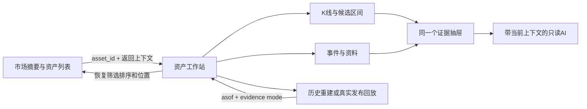

# 六站公开体验复盘与 LPPL 工作站优化方案

2026-11-17 · 桌面 Chrome · 仅研究与文档交付。

**建议把 LPPL 做成“围绕资产和时间区间组织的研究工作站”：保留浅色、非海洋方向，以 K 线和顶部候选为中心，把资讯、宏观、资料和 AI 变成可追溯的上下文。先完成一个连续流程，再扩展信息广度。** 这是设计判断（PROPOSED），不是模型效果结论。

本轮实际访问 Koyfin、Fiscal.ai、FINVIZ、Trading Economics、Quartr、金十，操作公开导航、筛选、日期/周期、公司页签及若干下钻路径。**没有完成六个产品所有深层功能的全覆盖**：登录、付费和加载问题阻断了一部分路径。打开页面、完成具体操作、读取官方说明分别记账；没有把宣传图当作终端实测。

## 阅读顺序与边界

- [浏览器证据第一部分](BROWSER_LOG_PART1.md)：Koyfin、Fiscal.ai、FINVIZ，含具体路径、结果与未测范围。
- [浏览器证据第二部分](BROWSER_LOG_PART2.md)：Trading Economics、Quartr、金十。
- [Devin 细化任务与新增验收](DEVIN_REFINEMENTS.md)：接入既有 U00–U11 / B0–B4，全部业务验收初始 NOT_RUN。
- [文档校验与独立审查](VALIDATION.md)：记录本次文档检查和没有验证的部分。
- [既有统一计划](../market-workstation-unified-plan-20261117/README.md)、[既有 A01–A34](../market-workstation-unified-plan-20261117/ACCEPTANCE_MATRIX.md)。此前 TradingView、Bloomberg、EasyK 的证据保留。

本轮文档基于 PR #110 head `0c63a1101ef3c71e8282299caf991ee4334b13e2`；当时 base main 为 `4a5e1375e6dbd9a5b442d16c876b69ccaff7d0b5`。没有重新审计 Devin 全部业务改动，不能将下文“应具备”写成“当前肯定缺失”。实施前由 U00 对照最新代码，逐项标记复用、补齐、新增。

证据口径：VERIFIED 仅确认本次可见界面/交互；DOC_ONLY 是官方文档或产品作者报告；NOT_ESTABLISHED 是未能建立结果或原因；NOT_INSPECTED 是未操作；PROPOSED / NOT_RUN 是设计与待执行验收。报价、新闻、数据真实性、AI准确性、模型预测力、许可完整性均不由界面体验证明。没有注册、购买、订阅通知、部署或运行模型；未上传账户或系统通知截图。

## 1. 覆盖与可借鉴能力

| 站点 | 真实完成的公开路径 | 明确限制 | 对 LPPL 最有用的部分 |
|---|---|---|---|
| Koyfin | 首页、产品入口、顾问/投资者定位页、Pricing；年/月付价格视图切换 | 产品页有加载/布局异常；终端持续加载，内部工具未测试 | 官网与工作台分工；资产与功能命令搜索的思路来自官方帮助，非实测 |
| Fiscal.ai | GOOG 公司 11 个主页签；7 个主要业务入口；Markets 7 页签；财务年/季、日历 Week/Agenda | 多数财务明细、研报、AI、建模需登录；10-Q 正文加载未完成；筛选器受限 | 固定资产上下文、多维资料页签、市场热图、披露时间字段 |
| FINVIZ | 14 个主入口均尝试；Technology 筛选→Performance 视图→AAPL→Weekly→返回原筛选；热图悬浮；经济事件展开 | Charts 升级墙，Watchlist/Portfolio 账户门槛；未创建策略或组合 | 列表与视图分离、保持筛选返回、紧凑比较、图表与表格互通 |
| Trading Economics | 6 个主导航均尝试；Today 日历→英国失业率→7 个指标页签；指数报价、指标和国家目录、国家预测目录 | News 超时；部分历史日期锁定；未保存国家筛选、设提醒、下载 | 宏观发布事件与时间序列关联；实际/前值/共识/预测四分法 |
| Quartr | 官网 Product/Use cases/Discover/Pricing；登录入口；AI、电话会、事件日历三份公开功能文档 | 终端登录墙；AI、音频/转录同步和原文定位未运行 | 一次公司事件组织多份材料；精确引用和并排阅读为 DOC_ONLY 借鉴 |
| 金十 | 首页6入口；分类→A股；日期权限提示；头条→早餐→文章；数据库7类；融资卡下钻 | 历史快讯会员墙，日历/数据明细登录墙，视频未播放 | 重要事项、实时快讯、每日总结分层；资料卡快速发现；中文信息密度 |

“全部主入口尝试”不等于所有子菜单、所有按钮、所有业务通过。完整例外以两份日志为准。390px、真实手机、Safari、键盘/读屏、弱网和大陆直连性能：NOT_INSPECTED。工具调用耗时不能当作网页测速。

## 2. 逐站专业评价

### 2.1 Koyfin：清楚区分获客与研究

**VERIFIED：** 官网大标题、简短价值说明、一个主要行动按钮；顾问页面强调研究与客户沟通，投资者页面强调投资研究。Pricing 用横向列比较产品等级，年/月视图切换后价签随之更新。白底和黑色行动按钮使入口清楚。

**本次问题：** Product 页样式或图片未完整呈现；终端多次观察仍加载。无法判断是站点、网络或当前浏览器环境所致，不作全站稳定性排名。投资者页的一部分主视觉未加载，也不能把它当作设计留白。

**PROPOSED：** LPPL 首页保留产品气质和一个主视觉，但第一屏就有资产搜索、最近研究、进入工作站。老用户不应每次经过完整动画。进入工作台后有行情和缓存结果，即使新分析未完成也可操作。命令搜索可借鉴 Koyfin [官方指南](https://www.koyfin.com/help/command-bar-search/)，先提供查资产、查页面、查帮助三类，不先实现复杂金融表达式。该指南标注最后更新于2021年，只用于理解交互思想，不作为当前全部功能已验证的依据。

### 2.2 Fiscal.ai：公司是资料导航的中心

**VERIFIED：** 在 GOOG 页依次访问 Overview、Financials、Investor Relations、Research、Estimates、News、Ownership、Industry、Dividends、Modeling、Filings。切换栏目保留公司上下文。财务页同时区分年度/季度、标准化/报告口径、币种/量级；实际财务值大量受限，因此只确认控件和页面变化。

**VERIFIED：** Markets 由 Overview、Heatmap、Top Stories、Gainers & Losers、Fund Letters、Insider Trades、Politician Trades 组成。热图不只靠颜色，大小和行业分组也表达信息。内幕交易区分成交与申报时间，政治人物交易还可见迟报标记。Earnings 的 Week 和 Agenda 都可打开；切换时日期范围也变化，不能当作仅改变布局。

**优点判断：** 资产身份稳定，资料类型明确，用户不必为“这家公司财报在哪里”反复搜索。财务数据的单位、周期和口径放在使用处，是金融 UI 的基础。

**本次摩擦：** 多处点进去后才看到登录/升级墙；10-Q 正文加载没有形成可验证阅读闭环。默认 Portfolio 出现产品示例持仓，应避免被误认作用户真实持仓。栏目多而内容可用性不统一，普通用户容易在锁定区域间游走。

**PROPOSED：** LPPL 资产页不照搬11个页签，先聚合为五组：图表与区间、资讯与事件、公司与财务、资金与结构、历史与评估。股票、指数、ETF按适用范围显示内容；指数不强行挂个股股东页。每项入口提前显示数据是否可用。行情注明复权口径；财务注明周期、币种及标准化/报告口径；公式入口应连到版本化指标定义。Fiscal.ai 的[帮助中心](https://fiscal.ai/help/)将数据源、更新频率、公式和计划权限分开说明，这可作为帮助结构参考，非授权或接入依据。

### 2.3 FINVIZ：效率来自状态保留和紧凑比较

**VERIFIED：** 在股票筛选器选择 Technology，结果从全市场缩小；切换 Performance 后筛选仍在；进入 AAPL，看到蜡烛图、成交量、均线和事件标识，切到周线后通过 Screener 返回，原 Technology 与 Performance 视图保留。这是本轮最完整、最值得复用的研究路径。

**VERIFIED：** 热图悬浮 AAPL 时出现股票价格小图与行业高亮；行情解释缺失时明确显示 unavailable。Futures、Forex、Crypto 使用相同的分类/小多图语法。经济日历将事件展开在原列表内，附历史图、来源和单位。

**本次摩擦：** 推广条和升级弹窗反复占据首屏；点击 Charts、Watchlist、Portfolio 遇到权限限制。经济日历一行所属期为 Nov，展开描述谈 June 2026，图末为 Oct：这是看到的时点不同，不能据此断言数据错误，但说明不同内容块需要分别标时和对齐检查。

**PROPOSED：** 把“资产集合”和“呈现方式”分开保存。同一自选集合可切行情表、候选区间表、事件表，切换不重建自选股。返回列表恢复筛选、排序、页码、滚动位置和所选行。热图以行业/概念/地域为分类轴，面积和颜色的指标各自有标签；悬浮只读缓存，不触发拟合。资料未加载时保留图表。首期不复制全部高级画图/组合/导出能力。

### 2.4 Trading Economics：一个指标，多种理解方式

**VERIFIED：** 从今日经济日历进入英国失业率后，Summary、Stats、Forecast、Consensus、Calendar、Alerts、Download 对应同一指标。Stats显示历史柱与统计线；Forecast将未来部分用不同颜色区分；Calendar将发布日期、所属观察期和实际/前值/共识/站方预测放在同一表内。Alerts只打开配置区域，未建立提醒。

**优点判断：** 它把“发生了什么、什么时候公布、历史上如何、未来预期是什么”拆成不同视角，底层仍是同一对象，适合 LPPL 的宏观事件与行情时间轴。

**本次摩擦：** News 路径最终超时；日期菜单的一些历史范围有锁。页面没有新式视觉也能清楚完成任务，但大量宽表、轻灰细字对小屏仍需要单独验证。

**DOC_ONLY：** [官方日历说明](https://tradingeconomics.com/calendar)区分官方实际值、修订前值、经济学家共识以及站方模型预测。**PROPOSED：** LPPL也应保留这四类来源，不能把Forecast列叫官方值；同一宏观序列每次发布/修订建立独立版本，历史回放选择当时已知版本。只有一张“最新值”卡不足以支持回放。

### 2.5 Quartr：研究证据应能回到具体位置

**VERIFIED：** 公开官网采用白底、黑字、明确留白和产品界面展示图；产品、客户场景、发现资源、价格分组清楚。终端进入登录页，不能完成公司事件播放、AI回答或引用下钻。

**DOC_ONLY／产品作者报告：** [AI chat](https://quartr.com/features/ai-chat)说明回答可以引用原始文档精确页并在旁边打开原文；[电话会与转录](https://quartr.com/features/live-calls-and-transcripts)及[事件日历](https://quartr.com/features/event-calendar)介绍事件资料和时间安排的关联。这些都没有被本轮独立验证为运行效果。

**PROPOSED：** LPPL AI 的价值应是解释当前结果与证据：回答“这个区间为何仍是观察”“和上次比改了什么”“当时已知哪些公告”。引用点击后打开具体公告页、表格单元、事件版本或模型窗口记录。AI不是重新猜一次顶部，不能把聚类支持比例变成校准概率，也不能根据新闻改写拟合。保留直接看图/看表的路径，用户不必先聊天才能使用网站。

### 2.6 金十：资讯有节奏，数据卡有分工

**VERIFIED：** 首页先给重要事件，再给按时序排列的快讯，右侧放专题与文章，底部固定行情条；分类可切到A股；头条里的金十早餐有按日文章，进入后先给摘要，再分市场盘点等段落。数据库按国家宏观、贵金属外汇、期货、股市、汇总资讯、小工具组织。

**优点判断：** 实时发生的、今天值得知道的、历史背景资料，入口不同，减少所有内容挤在一条流中。缩略图/迷你图使数据目录易扫描。

**本次摩擦：** 多次另开标签会造成返回链分散；推广、自动变化的搜索词与消息、底部行情同时竞争注意力。数据库中部分卡写“参考示意图”，另一些带日期和数值，真实性层次需要用户逐项辨认。融资融券明细和日历需要登录，历史快讯需要会员。

**PROPOSED：** LPPL用“今日三至五件事 + 与当前资产相关的事件流 + 完整资料目录”三层。新快讯到来只提示“有新消息”，不自动顶走正在阅读的位置；点击相关资产在同一工作站更新上下文，默认不连开多个标签。示例、缓存、历史与当前数据有永久标签。资金数据不得以余额代买入额；ETF规模、净申购、估算流量与持仓披露分别命名，不能把某类ETF买入直接写成“国家队”。

## 3. 不能照搬的共同问题

| 观察或风险 | LPPL 的处理（PROPOSED） |
|---|---|
| 登陆/付费墙与故障看起来都像“没数据” | 区分未接入、该资产不适用、权限不足、临时失败、确实为空、stale；只在受影响模块显示 |
| 首页产品图片貌似真实工作台 | 演示永久标识；可交互示例与真实分析明确区分；任何示例不写首次真实发布 |
| 同一页不同时点的数据混合 | 行情截止、分析截止、消息发布时间和抓取时间分别显示；不使用一个全局“实时”覆盖全部卡片 |
| 图表/表格切换丢掉筛选或时间范围 | 视图与研究上下文分离；若必须改变范围，事先显示变化，而非静默切换 |
| 模块多但没有核心任务 | LPPL首屏先答“哪个候选区间、什么状态、哪个尺度支持、数据到哪天、下一步看什么” |
| 每张卡都放一段风险声明 | 摘要内简短解释状态；详细依据到统一证据抽屉；保留必要的日期、限制和未知，不以冗长文案淹没结果 |
| 因竞品有某功能就新增接口 | 先证明用户任务需要，核对数据条件与已有实现；UI参考不等于取得数据展示/再分发许可 |

本轮看到金十日历页有关于未经授权用途的声明；这只确认页面存在该声明，不构成完整法律结论。此次没有采集其明细或接入商业转供。其他站点也不能因为公开可浏览就推定可批量保存、再发布或用于AI。延续原有逐源核验，不新开购买或许可流程。

## 4. LPPL 的整体信息架构

保持既有四个一级入口，避免每次评测再造一套菜单：

| 一级入口 | 二级导航 | 核心任务 |
|---|---|---|
| 市场 | A股 / 全球 / 宏观 / 资讯 | 知道市场发生什么，找到值得进一步研究的资产 |
| 工作站 | 图表与区间 / 资讯与事件 / 公司与财务 / 资金与结构 / 历史与评估 | 研究一只资产；切栏目保留资产、日期、结果版本 |
| 复盘 | 当日复盘 / 日期回放 / 提醒账本 | 回到特定交易日，分开看历史重建和真实发布 |
| 研究 | 方法 / 样本与评估 / 数据字典 / 使用指南 | 理解方法、口径和适用边界 |

全局搜索支持资产名称/代码/交易所和页面功能；导航不触发计算。市场菜单预览可展示分类指数、小图、涨跌和各自截止时点，点行进入工作站，点“查看全部”进入相应列表。触摸和键盘用点击/焦点打开，不能仅靠hover。

这是拟议结构，不是当前已运行系统图。共享资产与时间上下文，模块仍分别加载；新闻失败不拖住行情，当前分析不等待历史回放。

## 5. 界面质量如何落地

### 桌面工作站

1. 顶部全局导航和搜索；下一行固定资产身份、市场状态、数据截止与当前分析状态。
2. 首屏主内容：顶部候选摘要 + K线/成交量。摘要不藏在长报告底部；必须能一眼看到日期区间、观察/正式提醒状态、尺度支持和结果截止日。
3. 左侧可折叠自选与最近分析；右侧一个互斥的详情抽屉，在证据、事件、AI之间切换，不叠三层窄面板。
4. 下方二级资料表：选择事件/修订时，主图定位日期且保持可返回。详细参数、拟合窗口分布、研究评分进入证据层。
5. 新分析运行时保留旧结果，标题写明其分析截止日与新任务状态；历史回放由用户单独启动。

### 390px 与视觉层级

移动顺序为资产头 → 候选摘要 → 图表 → 资料，左侧自选改独立面板，右抽屉改一层全屏详情；返回恢复原来K线范围。横向财务表在表格内部滚动，整页不横溢。高频按钮触控区至少44px；屏幕小不代表要把所有字号压成10px。

浅色基底、深文字和蓝色交互是建议方向；行情涨跌单独使用可切换的市场惯例色。观察状态用琥珀/虚线，正式提醒用独立状态符号和明确文字，stale使用时钟/日期说明。状态不能只靠红绿，也不能让绿色品牌底与K线混成一片。最终颜色对比度需实际测试，不因提供色值而声称达标。

首页可有一次短动效、清楚的排版和主视觉；工作站动效只解释状态变化。切资产的骨架、选区定位、抽屉进入有轻动效即可。禁止每条报价不断闪烁、背景视频占用分析区、必须看完动画才能搜索。reduced-motion时所有功能完整；本轮没有进行竞品动画性能测试。

## 6. 把提醒写得有用，而非只写防御性结论

以下是模板，不是真实拟合结果：

> **顶部候选区间：{开始日期}—{结束日期}**  
> 状态：观察区间 · 支持尺度：{已验证支持的尺度}  
> 分析截止：{交易日} · 距区间开始：{按交易日历计算的天数}  
> 变化：{相对上一版本的新增/移动/收窄}  
> 尚未正式提醒的原因：{当前实际未满足条件的一句说明}  
> [查看聚类与窗口] [查看修订] [解释这个结果]

完整周期1.5不改。0–4交易日候选仍显示，至少提前5日作为评估切片；已经过去的tc标为历史临界点，不能计作新预报。结构支持占比、tc区间和真实预警表现分开。多尺度集中可能值得关注，但其“概率更大”必须经独立校准，UI不能直接宣称准确率。局部顶与阶段顶评分继续分开；不引入跌幅10%的成功定义。

## 7. 实施取舍与下一项具体交付

继续既有 B0–B4，不追加平行 P0–P3。先核对最新 main 与 Devin 工作分支；这些页面能力若已存在且通过验收，应复用。

| 顺序 | 交付 | 主要借鉴 | 完成判据 |
|---|---|---|---|
| B0 | 共享上下文、指标字典、数据能力矩阵与现状差异表 | Fiscal.ai / Trading Economics | 资产、单位、所属期、来源版本一致，已有模块可复用 |
| B1 | 上证/茅台行情先显示，顶部候选主屏可见；当前计算独立；自选→个股→返回 | FINVIZ | 返回后筛选与图表视野保留；不自动排104周；首窗/修订账本可查 |
| B2 | 市场分类预览、复盘列表、每日摘要和宏观发布卡 | 金十 / Trading Economics | 每卡时点和状态清楚；消息更新不打断阅读；P1封存链继续复用 |
| B3 | 精确证据抽屉、历史模式隔离、只读上下文AI | Quartr文档 + 原EasyK方案 | AI每项事实回到具体来源位置；历史不混入事后材料 |
| B4 | 桌面/390px、键盘、弱网/失败、指南与性能验收 | 六站共同反例 | 测试有结果与证据；未测环境不写通过 |

**下一次代码交付建议只取 B1 的一条完整路径：** 从市场列表选上证或茅台 → 立即看已有行情 → 读取缓存候选或看到清楚的计算状态 → 点击候选查看证据 → 返回原列表。把这一条做顺，再扩展资料面板。不要以新增十个静态入口作为“完成复刻”。

## 8. 教程、评估与反向审查

教程用三个短任务组织：第一次看区间；理解观察与修订；回到某日比较当时已知资料。帮助链接跟随当前模块，解释单位/周期/时间含义；不用全屏强制巡游。至少保留“为什么暂时没有结果”“为什么这只是观察”的直接入口。

建议记录以下产品指标，先建立基线再设目标（当前均 NOT_RUN）：行情首次可用时间、缓存结果首次可用时间、任务完成率、返回上下文恢复率、找区间所需操作数、证据点击到原始位置成功率、错误状态下继续阅读成功率。冷/热缓存、桌面/移动、网络条件分开记录；不能把LCP等同于分析结果可用。

反向审查结论（设计判断）：

- 功能密度上升不等于价值上升。任何新卡必须回答“用户用它做什么、下一步去哪”。
- 不复制竞品的海量锁定入口、广告、内容订阅催促和示意数值；能力未接入时不要让用户反复点空页。
- 首页审美、资料完整度、模型预测效果是三条独立验收轴。界面漂亮不能证明模型准确；严谨文案也不能成为把候选藏起来的理由。
- UI只读缓存不意味着永远不刷新。stale要解释哪层旧、为何旧、是否正在刷新、用户能做什么，并保留最后可用结果。
- 本次不替换图表库、不改LPPL拟合、不重跑全市场、不为对标而新增自由拖拽大屏或交易执行。
- 未测试的终端和移动端保留为未测；本地单次连接失败不等于大陆网络不可用，须另做有时间/线路记录的测试。

## 9. 验证范围

浏览器实际路径与限制见日志；新增设计验收见 DEVIN_REFINEMENTS。文档检查仅验证文件、链接、证据标记和任务一致性。所有待实现业务改造仍为 PROPOSED / NOT_RUN。报告更新到 Draft PR 不等于合并、部署或发布，也不代表已向 Devin 服务发送任务。
