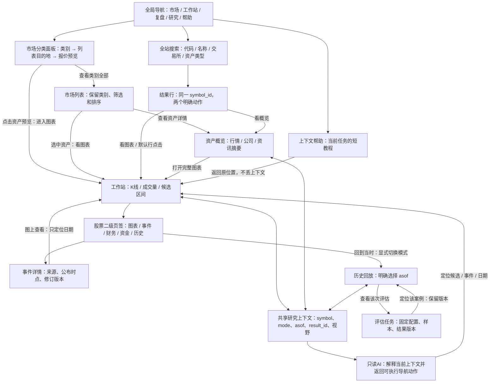
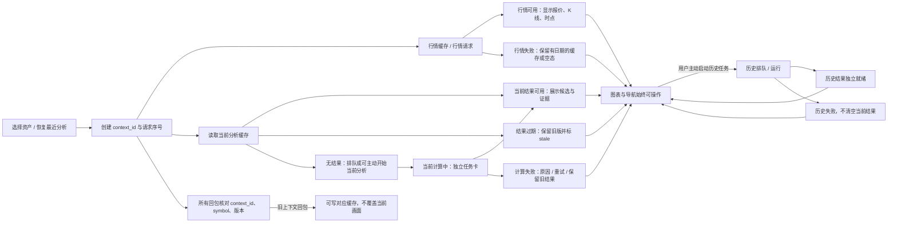

# 路由联系图与对抗性设计审查

日期：2026-11-16。本文是导航规格的补充，不重复完整菜单设计。

证据边界：主任务传入的本轮实操记录为 **VERIFIED/UI（主任务记录）**；下述 Mermaid、路由名称、状态和验收为 **PROPOSED / NOT_RUN**。子任务没有控制Chrome或测试业务代码。

## 1. 本轮操作对设计的约束

- **VERIFIED/UI（主任务记录）** 五类顶栏菜单均已逐个悬停；Markets→Indices形成三列。右列本次只有报价卡，没有逐行sparkline；不能把计划新增的小图写成已经亲测到的TradingView行为。
- **VERIFIED/UI（主任务记录）** 一次D标记提示显示延迟10分钟；这只是所检查项目的提示，不外推至全部指数或行情。
- **VERIFIED/UI（主任务记录）** Products下展开过Screeners与Calendars，More→Help实际搜索strategy。
- **VERIFIED/UI（主任务记录）** 全站AAPL结果行提供Launch chart和See overview两种动作，点击结果行默认进入Supercharts。因此标的实体可以共用，而入口目的地不同。

## 2. 路由与上下文连接图

这是LPPL建议逻辑，**不是TradingView内部路由实现**。保留现有静态路由兼容层即可，不要求一次改成SPA。

连接约束：

1. `symbol_id`采用规范化身份，包含交易所；裸代码仅为输入别名。导航先解析实体，再选择目的地，不能通过显示名称字符串决定股票或指数。
2. 搜索两个动作须有不同标签；默认行点击的目的地固定，不随鼠标位置或历史用户状态随机改变。打开新标签仍可用真实链接。
3. “查看概览”与“完整图表”共用资产身份，不要求共用全部视图状态。概览展示最新数据时明确为current，不能无声继承一个旧回放日。
4. 事件“图上查看”仅改变focus/visible_range；只有“回到当时”才设置replay/asof。否则点击公告就改变模型时点，会让用户失去位置。
5. 返回上一步恢复页签、筛选和视野；旧结果的恢复不等于刷新，更不等于重跑模型。
6. 分享链接包含可公开解析的symbol/mode/asof/result引用；私有笔记、会话正文、token和无授权快照不进URL。没有权限时返回明确缺失，不回退到另一份结果。

## 3. 行情、当前分析与历史任务的状态联系

下图为界面状态建议，不替代后端现有命名。不同任务并行，不能用一个全屏loading覆盖所有内容。

必须同时保存`quote_asof`与`analysis_asof`。行情已更新、模型未更新是合法组合；UI需要可见地区分。报价delay、缓存stale和模型旧日期是三种不同状态，不能统一显示一个黄色点。

当前结果、历史重放、策略回测也不是同一个实体。策略报告须关联固定run_id/config_hash；切图表标的或周期后，旧报告保留原身份并标“不对应当前图表”，或明确重新运行，不能只换标题。

## 4. 对抗性场景与验收

所有案例为 **PROPOSED / NOT_RUN**。这些是最少需要复现的反例，不是断言TradingView或LPPL已出现同类缺陷。

| 场景 | 容易发生的错误 | 必须成立的行为 / fixture |
|---|---|---|
| 快速从上证切茅台，再切回 | 迟到响应把上一个标的写入当前卡 | 三个延迟顺序不同的响应；所有主图、报价、AI和研究摘要都核对context_id |
| 鼠标横跨Markets三个栏目 | 菜单过早关闭，或悬停就触发页面跳转 | hover仅预览，点击才导航；斜向经过列间空隙不丢菜单 |
| 用户在搜索结果同时看到两种动作 | 名称点击、按钮点击的行为不一致且不可预期 | 默认行点击固定进入图表；“看概览”显式进入概览；键盘可选择两个动作 |
| D标记、stale标记与模型旧日期同时存在 | 延迟行情被误读为数据请求失败，或旧模型被当最新 | 三字段分别展示含义；测试10分钟延迟且缓存新鲜、实时源但缓存旧、模型旧三种组合 |
| 行情卡1日涨幅为正，60日迷你图向下 | 用户认为颜色/数据错误 | 两个期间分别标清；小图不冒充当天分时，颜色基准一致可解释 |
| 周末/节假日后延长未来区间 | 未来日期向前/后漂移 | 原始tc日期保持；日历版本明确；自然日/交易日映射不静默替换 |
| 只有1个点或历史中有缺数 | 小图除零、补成水平线或跨缺口连续 | 少于2点标历史不足；平盘真实水平线；未知值断线 |
| 正在看2026年6月回放，打开今日公告 | 未来事件混入历史研究 | 提示该事件当时不可知；用户明确选择后才离开回放，不能自动切换。as-of模式下隐藏或标事后补充，不参与回答 |
| 正在看历史时刷新行情 | 自动跳到最新，打断用户 | 保持visible_range；出现新数据提示，用户主动返回最新 |
| 从参数页改策略再看旧报告 | 旧绩效被误标成新参数成绩 | 参数草稿与已运行配置分开；报告常驻标的、周期、样本区间、config_hash和生成时点 |
| 在交易回测页看顶部模型 | 用收益率替代顶部时间命中率 | 交易规则/成交假设与顶部事件评分分开；只预测时间窗时不能制造交易盈亏 |
| 菜单行情来源失效 | 菜单打不开或自动发起模型任务 | 静态导航仍可用，旧数据带时点或空态；导航预览无模型执行副作用 |
| 390px设备打开三列导航 | 点击目标过窄、缺hover导致无法进入 | 单列逐级前进/返回；可见关闭，44px触控目标，焦点恢复 |
| 登录与未登录混用缓存 | 私有自选或最近分析泄露 | 私有列表按用户隔离；允许共享的公开行情另缓存；登出清理私有可见状态 |
| AI工具返回旧result_id | 回答看似解释当前候选，实际引用上次 | 卡片显示证据版本；只读工具拒绝不匹配上下文；旧答显式标旧 |
| 浏览器后退/刷新/复制链接 | 返回其他资产、丢历史日或恢复成最新 | 路由round-trip测试；相同公共参数恢复同一身份，缺少记录明确失败而非偷偷替代 |

## 5. 最小验收记录模板

每条记录：`case_id / entry_route / action / expected_context / actual_context / data_version / screenshot_or_log / PASS|FAIL|NOT_RUN / reason`。

首批至少覆盖：搜索→图表、搜索→概览、市场预览→资产、事件→图上定位、显式历史回放→退出、评估报告→案例回放、自选→最近结果恢复、Help→返回原处。每条均做桌面鼠标、键盘和390px触控等效路径；未执行的环境保留NOT_RUN。

阻断上线：串标的、串时点、未来信息进入历史解释、错误日期映射、旧回测结果冒充新参数成绩、导航触发未请求的重算、近端候选被5日阈值隐藏。美观和过渡动画不能抵消这些失败。
