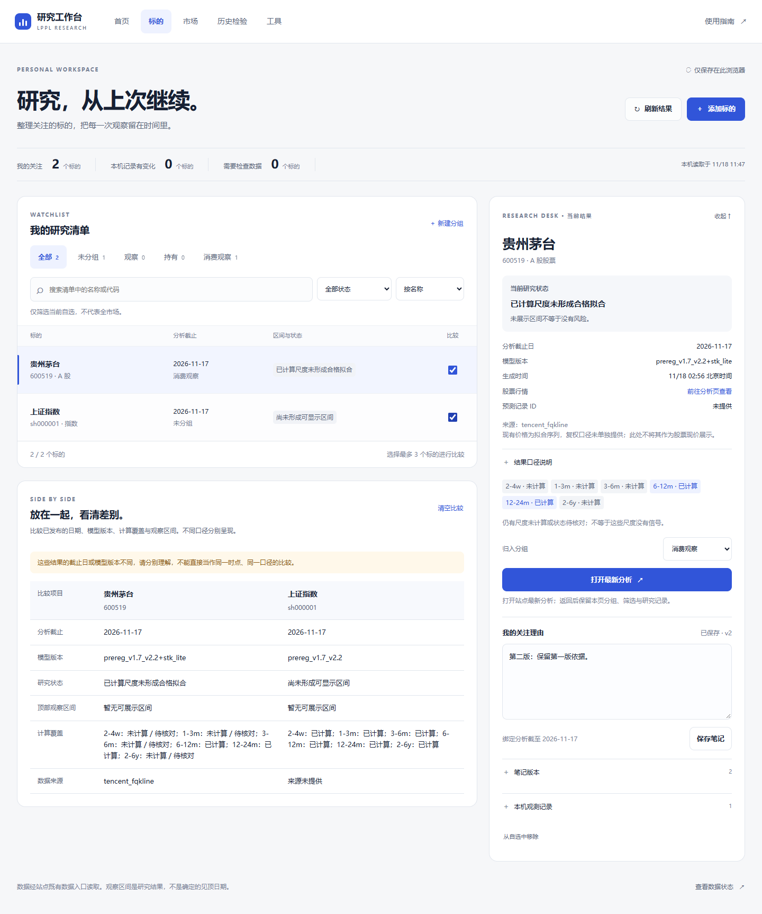
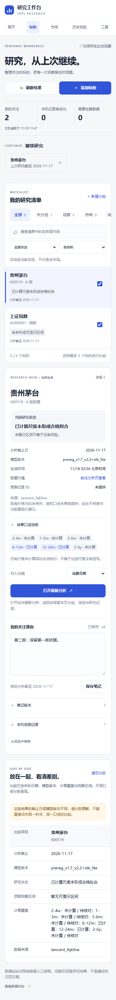

# 研究工作台验收记录 — 2026-11-18

> 历史验收：本文的 391 / 12 项结果对应 `dbc8c00`。扩展实现与更新后的测试结果见 [专业细节交付与验收](professional-details-2026-11-18.md)。旧结果和原始归档样本说明保留。

基线：`dca1f20a0e95841aff925f2513215c857673310f`。交付入口：`frontend/research-workspace.html`。本记录只证明下列明确范围，不把静态或夹具测试等同于生产服务可用性。

## 已核验

| 项目 | 结果 | 证据边界 |
|---|---|---|
| 全量前端及 Worker Node 测试 | VERIFIED — 391 passed，0 failed | 包含新增 31 项核心测试；没有运行模型 |
| 浏览器操作回归 | VERIFIED — 12 项检查通过 | Chrome 157 headless，1440×1000、390×844 |
| 两标的真实归档样本 | VERIFIED — 同一浏览器回归 12 项通过 | 上证、茅台 asof=2026-11-17，使用此前读取公开站点保存的原始 JSON；不是本次实时网络验收 |
| 无假初始自选 | VERIFIED | 空存储为 0；示例需用户点击添加 |
| 旧自选互通 | VERIFIED | 沿用 `lppl.watchlist.idx.v1` 与 `lppl.watchlist.v1` |
| 添加期间慢请求 | VERIFIED | 首个指数响应人工延迟 1200ms；此期间加入第二只股票，自动合并待刷新任务，最终两只均加载 |
| 分组、搜索与笔记版本 | VERIFIED | 刷新后保留；笔记含 HTML 字符仅按文字显示 |
| 无分析时记录理由 | VERIFIED | 可保存空 asof 的明确未关联笔记，不编造预测身份 |
| 比较、返回、键盘与 reduced-motion | VERIFIED | 比较不同日期/版本显式提示，返回同源固定工作台路径，列表重绘保留焦点 |
| 精确恢复近期研究 | VERIFIED | 相同资产不同模型/预测身份逐项匹配；同内容身份更新不增加新的观察变化 |
| 存储失败 | VERIFIED | 写入失败可见；笔记追加回滚并保留草稿；核心测试验证旧标签页覆盖拒绝 |
| 证据门控 | VERIFIED | 未知/失败/未计算尺度不显示日期；descriptive 必须有 n，个股 research_candidate 不升级描述性证据 |
| 独立审查 | VERIFIED | 四项发现修复并复验；31 项核心测试独立重跑通过 |
| `git diff --check` | VERIFIED | 提交前检查通过 |

Windows 本地 checkout 的自动 CRLF 转换会令既有 LWC 字节哈希和一项精确换行匹配测试失败。验证时恢复这两个**未修改文件**的 Git blob 原始字节后，全量 391 项通过；没有把行尾、vendor bundle 或市场页变更纳入本 PR。CI 的 Linux checkout 使用仓库原始字节。

## 浏览器回归的 12 个检查

1. 首访无虚构自选或模型结果。
2. 请求进行时添加第二个标的，两种旧自选键保持一致。
3. 分组和纯文本笔记持久化。
4. 笔记版本与清单筛选恢复。
5. 带独立日期的结构化比较。
6. 键盘选择后重绘仍保留焦点。
7. 原分析页有明确的返回路径。
8. 390px 无全页横向溢出，弹窗可关闭，减少动效模式可用。
9. 存储写入失败可见。
10. 结果读取失败仍可使用清单和保存关注理由。
11. 恢复正确的模型及预测身份，不制造额外提醒。
12. 无未捕获浏览器异常。

测试路由将外部请求替换为离线响应；工作台加载不提交模型、历史或 AI 请求。原分析页自身的网络行为由既有实现负责；本次不把其全部后端链路标为通过。

## 真实归档样本

| 标的 | 原始来源 | asof | SHA-256 |
|---|---|---|---|
| 上证指数 | `https://careypang.github.io/LPPL/lab/mock/data/sh000001_latest.json` | 2026-11-17 | `9d671462e03e8c96bbbead86cdc7eefd08ab2b0f3b9cb3725b08f2a788074b5c` |
| 贵州茅台 | `https://careypang.github.io/LPPL/lab/mock/data/stock/600519.json` | 2026-11-17 | `7c9461b26181e5228352017ea9d5976cb853f217e858901439bd2a3d8469b948` |

两者均保留源日期和模型版本；截图中的分组、笔记属于验收输入，不是用户真实持仓或投资判断。

VERIFIED：茅台该份模型 `price_history` 最后数值为 12948.039，源没有单独给出明确复权方式。NOT_ESTABLISHED：该拟合序列与未复权成交价的完整对应口径。工作台因此不将股票拟合序列作为现价展示；以文字提示并链接原行情页。不能据此直接认定上游数据错误，也不能推断为某种复权方式。

## 视觉记录

以下为上述归档样本在本地页面的渲染截图；不是已部署站点截图。

桌面：



390px：



截图位于 `frontend/docs/visual-evidence/`，既有构建脚本会排除该目录，不增加正式站页面下载负担。

## 未建立及未检查范围

- NOT_INSPECTED：真实手机、Safari、Firefox、屏幕阅读器、大陆网络与低带宽实际表现。
- NOT_INSPECTED：生产 Worker、实际行情刷新、账户、通知投递与云同步。
- NOT_ESTABLISHED：模型预测准确率提高、阶段顶漏报降低、严格前瞻获利；本次没有重跑或修改模型。
- NOT_ESTABLISHED：本机时间等同首次公开预测时间、完整服务器修订史、跨设备永久保存。
- NOT_IMPLEMENTED：全市场筛选、真实持仓、推送、事件日历与完整图表绘图；后续任务见设计报告 W01–W10。

## 复现

仓库标准检查：

```sh
node --test frontend/tests/*.test.cjs workers/stock-query/test/*.test.mjs
```

浏览器检查需现有 Playwright 安装。测试自己启动并关闭仅绑定 `127.0.0.1` 的临时服务，不需要发布站点：

```sh
node frontend/tests/research-workspace.browser.cjs
```

可选环境变量：

- `LPPL_PLAYWRIGHT_MODULE`：已有 `playwright` 或 `playwright-core` 的模块目录。
- `LPPL_BROWSER_EXECUTABLE`：已有 Chromium/Chrome 可执行文件；不设置则使用 Playwright 默认浏览器。
- `LPPL_SCREENSHOT_DIR`：截图目录，按工作区规则放在 D 盘分析缓存目录。
- `LPPL_PUBLISHED_SAMPLE_DIR`：已封存样本目录，文件名为 `sh000001_latest.json`、`stock_600519.json`；不设置则使用仓库测试夹具。

GitHub CI 状态应以 PR 当前提交的检查结果为准，不以本地结果代替远程 CI。本 PR 不改工作流，不自动合并，不触发 Pages 部署。
