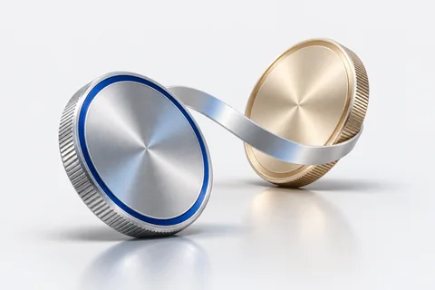
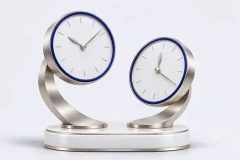
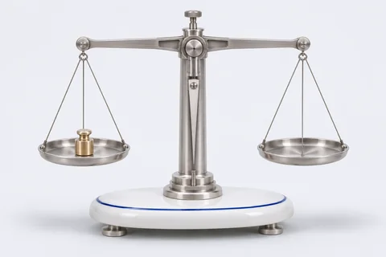
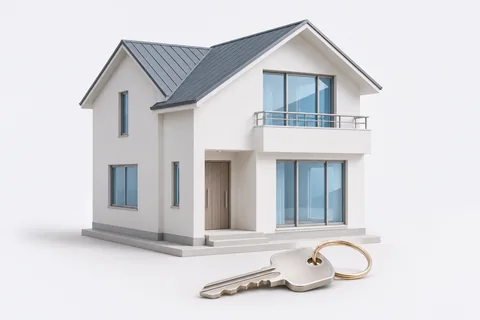
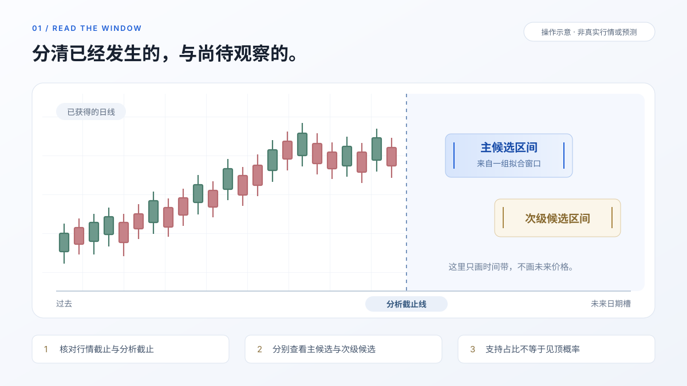
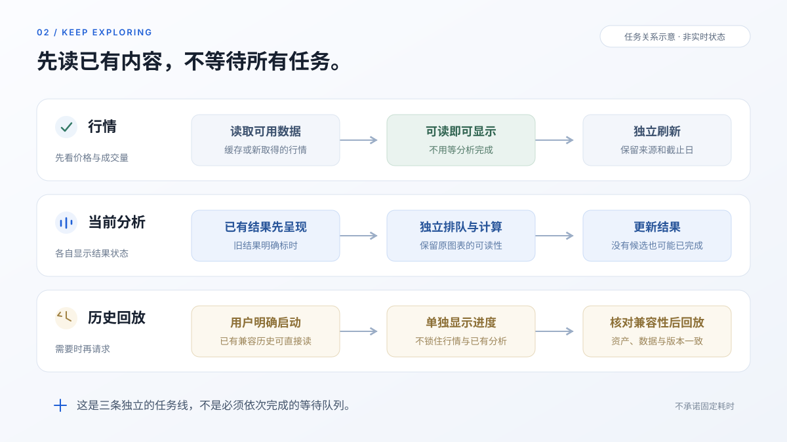
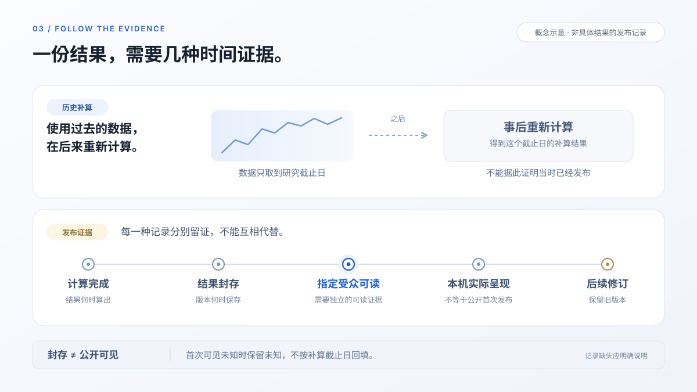

# 首页、工具与教程配图交付说明

日期：2026-11-17。范围为 **1 张首页主视觉、6 张工具卡配图、3 张原创教程图解**，配套 7 张 PNG 原稿和 14 个 WebP 变体。此文提供准确的页面放置规则、素材清单与验收边界；不宣称页面 QA 已通过。

## 视觉方向与使用边界

采用浅色精密静物、透明玻璃、拉丝金属与蓝金点缀，把主视觉与数值内容分开。概念图负责入口识别和视觉层次；真实行情、工具数值、时间区间与来源状态继续由 HTML 和数据层生成。七张静物为 AI 原创概念图，三张教程为原创 SVG 代码；未搬用第三方图片。

- 装饰图不是行情、报价、时钟读数、预测结果或模型证据。
- 教程图是阅读与任务关系示意，不代表所有联动、发布证据和修订功能均已实现。
- LPPLS 临界时间、候选簇支持占比与真实见顶概率是不同概念；不从配图推断预测能力。
- 首页原有数据图 `#t1`、`#t2`、`#t3`、`#t4` 保留，不以静物图替代。

## 编号与页面位置

以下 selector 指向当前 HTML 中的实际图片元素；工具页的 `:has()` 用于说明定位关系，无需在业务代码中增加依赖。

| 编号 | 配图与入口 | 精确位置 / selector |
|---|---|---|
| **H01** | [多尺度汇聚主视觉](../home.html) | `.hero-art .visual-media img`；首页首屏右侧主视觉；移动端接在首屏文案后 |
| **T01** | [汇率换算](../tools.html) | `#tools .card:has([data-tool="fx"]) .visual-media img`；工具网格对应卡片顶部，位于标题、参数预览与打开工具按钮之前 |
| **T02** | [时差与交易时钟](../tools.html) | `#tools .card:has([data-tool="tz"]) .visual-media img`；工具网格对应卡片顶部，位于标题、参数预览与打开工具按钮之前 |
| **T03** | [单位换算](../tools.html) | `#tools .card:has([data-tool="unit"]) .visual-media img`；工具网格对应卡片顶部，位于标题、参数预览与打开工具按钮之前 |
| **T04** | [金银价格换算](../tools.html) | `#tools .card:has([data-tool="metal"]) .visual-media img`；工具网格对应卡片顶部，位于标题、参数预览与打开工具按钮之前 |
| **T05** | [金价汇率情景](../tools.html) | `#tools .card:has([data-tool="scen"]) .visual-media img`；工具网格对应卡片顶部，位于标题、参数预览与打开工具按钮之前 |
| **T06** | [房贷计算器](../tools.html) | `#tools .card:has([data-tool="loan"]) .visual-media img`；工具网格对应卡片顶部，位于标题、参数预览与打开工具按钮之前 |
| **G01** | [先看日期，再看区间](../guide.html) | `#read-window .guide-figure img`；对应章节标题与引导段落之后、三点阅读说明和回到真实页面按钮之前 |
| **G02** | [行情、分析与回放分别进行](../guide.html) | `#independent-tasks .guide-figure img`；对应章节标题与引导段落之后、三点阅读说明和回到真实页面按钮之前 |
| **G03** | [找到结果背后的证据](../guide.html) | `#evidence-replay .guide-figure img`；对应章节标题与引导段落之后、三点阅读说明和回到真实页面按钮之前 |

## 可视参考与替代文本

缩略图均链接至该素材的仓库内文件；不从第三方 CDN 加载。WebP 用于页面交付，PNG 保留为原稿。教程 SVG 自身即为交付原稿。

### H01 · 多尺度汇聚主视觉

用层叠玻璃折面表达多尺度观察，不绘制行情、时间区间或胜率。

**Alt 策略：** 保留非数据声明的说明性替代文本：

> 蓝金色光线沿层叠玻璃片交汇的原创装置

[原稿](../assets/visual-suite/masters/hero.png) · [WebP 640 × 427](../assets/visual-suite/hero-640.webp) · [WebP 1536 × 1024](../assets/visual-suite/hero-1536.webp)

### T01 · 汇率换算

金银色金属片与环形连接，辅助识别汇率换算入口。

**Alt 策略：** `alt=""`，外层 `.visual-media` 使用 `aria-hidden="true"`。卡片标题、说明、数值与操作由独立 HTML 表达，避免屏幕阅读器重复朗读装饰图。

[原稿](../assets/visual-suite/masters/fx.png) · [WebP 480 × 320](../assets/visual-suite/fx-480.webp) · [WebP 960 × 640](../assets/visual-suite/fx-960.webp)

### T02 · 时差与交易时钟

双表盘表达时区差异；图内指针只作装饰，不承担实时时钟。

**Alt 策略：** `alt=""`，外层 `.visual-media` 使用 `aria-hidden="true"`。卡片标题、说明、数值与操作由独立 HTML 表达，避免屏幕阅读器重复朗读装饰图。

[原稿](../assets/visual-suite/masters/clock.png) · [WebP 480 × 320](../assets/visual-suite/clock-480.webp) · [WebP 960 × 640](../assets/visual-suite/clock-960.webp)

### T03 · 单位换算

等臂秤表达单位与量纲换算；不提供实际测量读数。

**Alt 策略：** `alt=""`，外层 `.visual-media` 使用 `aria-hidden="true"`。卡片标题、说明、数值与操作由独立 HTML 表达，避免屏幕阅读器重复朗读装饰图。

[原稿](../assets/visual-suite/masters/units.png) · [WebP 480 × 320](../assets/visual-suite/units-480.webp) · [WebP 960 × 640](../assets/visual-suite/units-960.webp)

### T04 · 金银价格换算

无文字金银锭，辅助识别贵金属换算入口。

**Alt 策略：** `alt=""`，外层 `.visual-media` 使用 `aria-hidden="true"`。卡片标题、说明、数值与操作由独立 HTML 表达，避免屏幕阅读器重复朗读装饰图。

[原稿](../assets/visual-suite/masters/metals.png) · [WebP 480 × 320](../assets/visual-suite/metals-480.webp) · [WebP 960 × 640](../assets/visual-suite/metals-960.webp)

### T05 · 金价汇率情景

同一金锭经两块棱镜观察，表达情景对照；不表示涨跌预测。

**Alt 策略：** `alt=""`，外层 `.visual-media` 使用 `aria-hidden="true"`。卡片标题、说明、数值与操作由独立 HTML 表达，避免屏幕阅读器重复朗读装饰图。

[原稿](../assets/visual-suite/masters/scenario.png) · [WebP 480 × 320](../assets/visual-suite/scenario-480.webp) · [WebP 960 × 640](../assets/visual-suite/scenario-960.webp)

### T06 · 房贷计算器

建筑模型与钥匙表达贷款计算入口；不表示房价或收益。

**Alt 策略：** `alt=""`，外层 `.visual-media` 使用 `aria-hidden="true"`。卡片标题、说明、数值与操作由独立 HTML 表达，避免屏幕阅读器重复朗读装饰图。

[原稿](../assets/visual-suite/masters/mortgage.png) · [WebP 480 × 320](../assets/visual-suite/mortgage-480.webp) · [WebP 960 × 640](../assets/visual-suite/mortgage-960.webp)

### G01 · 先看日期，再看区间

历史K线止于分析截止线；未来区域只显示候选时间带，不画未来价格。主候选与次级候选保留分歧。。

**Alt 策略：** 保留非数据声明的说明性替代文本：

> 操作示意：历史K线止于分析截止线；右侧未来日期槽只有两个候选时间带，没有未来价格。主候选与次级候选分别呈现。

[原稿](../assets/visual-suite/guide-window.svg)

### G02 · 行情、分析与回放分别进行

分别解释行情读取、当前分析与按需历史回放，避免将任务示意误认作真实运行状态或固定耗时承诺。。

**Alt 策略：** 保留非数据声明的说明性替代文本：

> 任务关系示意：行情读取后即可查看，当前分析独立更新，历史回放由明确操作启动。三项不是一个串行等待队列。

[原稿](../assets/visual-suite/guide-tasks.svg)

### G03 · 找到结果背后的证据

区分历史补算与真实发布证据；计算、封存、指定受众可读、本机呈现与修订不是同一时点。未知不回填。。

**Alt 策略：** 保留非数据声明的说明性替代文本：

> 证据概念图：历史补算从过去的数据截止点，到之后的重新计算；发布证据则分别记录计算、封存、指定受众可读、本机呈现和后续修订。封存不等于公开可见，未知时间不能回填。

[原稿](../assets/visual-suite/guide-evidence.svg)

## 新教程入口与页面关系

新增 [guide.html](../guide.html)，按三个步骤带用户回到真实功能：

1. `#read-window`：读行情截止日、分析截止日与不同候选时间带 → [指数图表](../index.html)。
2. `#independent-tasks`：理解行情、当前分析、按需历史回放的各自状态 → [个股工作站](../stock.html)。
3. `#evidence-replay`：区分补算、封存、可读与实际呈现证据 → [历史评估](../backtest.html)。

首页 `#evidence .guide-teaser`、首页页脚“图解使用指南”及公共导航的“用户指南”指向新入口。原研究说明源文件 [web/guide.html](../../web/guide.html) 保留，构建后路由为 `lab/guide.html`，标为历史研究／深入方法说明。新教程不会自动启动模型或历史计算。

## 交付格式与加载约定

- PNG 原稿：1536 × 1024、3:2、不透明背景；原稿用于追溯，不直接加载到正式页面。
- WebP：**sharp 0.35.5**、**quality 84**，按源比例缩放，无内容裁切；480 / 960 用于工具卡，640 / 1536 用于首页。640 宽变体因整数像素取整为 640 × 427。
- 三张 SVG：1200 × 675，保留可审查矢量形状和文字；未用生成式图片模型重绘。
- 首页图片使用 `srcset` / `sizes`、显式宽高和高优先级；工具卡首行 eager，后续 lazy；教程首图高优先级，后两图 lazy。
- 图片失败时展示独立 fallback，工具标题与操作仍留在 HTML 中。
- 首页仅在精细指针与允许动效时启用小幅位移；工具卡 hover 轻微缩放；`prefers-reduced-motion` 关闭这些图片动效。
- 交付没有声音、视频或新的外部媒体请求。

这些是当前代码中的设计与加载约定，浏览器行为、异常场景与响应式验收由主任务执行并单独记录。

## 文件账本

所有路径相对仓库根目录。完整文件哈希与 Git blob SHA 同时保存在 [manifest.json](../assets/visual-suite/manifest.json)。SHA-256 对内容字节计算；Git blob SHA 按 `SHA1("blob " + byte_length + NUL + bytes)` 计算。

| 文件 | 尺寸 | 字节 | SHA-256 |
|---|---:|---:|---|
| [clock-480.webp](../assets/visual-suite/clock-480.webp) | 480 × 320 | 10,610 | `85a23a033c0f00115120cfbc48dd8bbfa677706d1371348b84dd8086e7895650` |
| [clock-960.webp](../assets/visual-suite/clock-960.webp) | 960 × 640 | 29,476 | `abe46845794719900c1d476ead5d51967e55496b0ce2375a681b95ce2512e045` |
| [fx-480.webp](../assets/visual-suite/fx-480.webp) | 480 × 320 | 10,762 | `48955449f828a010c6a16ffa5428a329e3810feedff4d793e81ee149ee908f8a` |
| [fx-960.webp](../assets/visual-suite/fx-960.webp) | 960 × 640 | 33,258 | `4c799997382a22082afe629fbfdab42b8a017449ef3454f2487fd4f867a17ddd` |
| [guide-evidence.svg](../assets/visual-suite/guide-evidence.svg) | 1200 × 675 | 5,398 | `87f27b69881a8ad757da5f2df24d17bd48b29cf824831a3da192d88ec67a7481` |
| [guide-tasks.svg](../assets/visual-suite/guide-tasks.svg) | 1200 × 675 | 6,277 | `d8dcd9c200d78bc67b5726242a3f0ccbc7f97ebcd6b30039785159ce2399167f` |
| [guide-window.svg](../assets/visual-suite/guide-window.svg) | 1200 × 675 | 5,622 | `9fd785f77729a385a7629cffa4cef33d27fdf99f4c19927a897620e05ae6f03e` |
| [hero-1536.webp](../assets/visual-suite/hero-1536.webp) | 1536 × 1024 | 90,978 | `0d1f223ae92650258ea2185cc208da988d8cee08940bca7db717a2079758c3ad` |
| [hero-640.webp](../assets/visual-suite/hero-640.webp) | 640 × 427 | 25,390 | `1a07c67f33e40cc7949c57f7068407301ad741cc607dce766fce720875b9a441` |
| [masters/clock.png](../assets/visual-suite/masters/clock.png) | 1536 × 1024 | 1,771,520 | `9794c0e65e1a028e51487d647ad5cf55acff949b9cd3ddc3e70f2a4b365bfed9` |
| [masters/fx.png](../assets/visual-suite/masters/fx.png) | 1536 × 1024 | 1,874,367 | `75ee676055a83659b3f40388820f92573a6fdb699be75aedcbf90dbd909acd85` |
| [masters/hero.png](../assets/visual-suite/masters/hero.png) | 1536 × 1024 | 1,850,625 | `65ea85527148cfd7b7a40afdbd1c7e82493df8957fab32bee17b0b40078f5863` |
| [masters/metals.png](../assets/visual-suite/masters/metals.png) | 1536 × 1024 | 2,072,314 | `331ace6b41337d059e573bda2ee335f19f77e8e6b06733fb8f91d66cbb2eb365` |
| [masters/mortgage.png](../assets/visual-suite/masters/mortgage.png) | 1536 × 1024 | 1,830,552 | `771f221dd12296b09e0619d350da88cb5d9310c6ed289d5691ee3634a96255aa` |
| [masters/scenario.png](../assets/visual-suite/masters/scenario.png) | 1536 × 1024 | 1,677,651 | `ebef39a450484afa43da91a0116d02163b26415a20c435bb45359b152c4b83c6` |
| [masters/units.png](../assets/visual-suite/masters/units.png) | 1536 × 1024 | 1,672,745 | `b6f2c7860a90b2557248b5d15b5c88c231c80df6ffd1f6c6210b2ccef730654e` |
| [metals-480.webp](../assets/visual-suite/metals-480.webp) | 480 × 320 | 7,782 | `72841e2482cc1d42427e2646c02ed13e87386b5c84b6b9ef66480fed478155bb` |
| [metals-960.webp](../assets/visual-suite/metals-960.webp) | 960 × 640 | 27,120 | `d0e942a7576316699793a9a9b34604b9c34a14b720436b26aff59db9c2322c0e` |
| [mortgage-480.webp](../assets/visual-suite/mortgage-480.webp) | 480 × 320 | 9,040 | `1150e199edf3df74dde76508d06103bf2ba267e52db984dcb25a908c7577a319` |
| [mortgage-960.webp](../assets/visual-suite/mortgage-960.webp) | 960 × 640 | 26,286 | `19aed165b393ff7c68e9e6b5ea81c5bec8883125396c9a92d1642bf08fb77b8e` |
| [scenario-480.webp](../assets/visual-suite/scenario-480.webp) | 480 × 320 | 7,210 | `a06b2d56b6df359ade2aef99a7b9d49be8c6ae1fad884d7a8a989bc3b73a3841` |
| [scenario-960.webp](../assets/visual-suite/scenario-960.webp) | 960 × 640 | 19,274 | `6191434e3b28381e8a5df467c00818f34e5babb4d1507c80538a5f7acdd2c2e7` |
| [units-480.webp](../assets/visual-suite/units-480.webp) | 480 × 320 | 8,580 | `3fe9a7a3bbc7004b13991e849b463bff1a07c11ddc71c090a1a78bd77cfacc51` |
| [units-960.webp](../assets/visual-suite/units-960.webp) | 960 × 640 | 21,844 | `79039994e35d4ee20f7aba664a4ed28cbee4e186689b1526a48154ea4eea3586` |

体积合计：PNG 原稿 12,749,774 字节；全部 WebP 变体 327,610 字节；教程 SVG 17,297 字节。页面按响应式选择变体，不会正常同时加载全部 WebP。

生成提示词及教程图解设计要求见 [PROMPTS.md](../assets/visual-suite/PROMPTS.md)。Manifest 包含 24 个图像文件与两份说明文档；为避免自引用，不记录 manifest 自身的内容哈希。其他页面／脚本源文件不在素材账本的哈希范围内。

## 验收与交接状态

**页面验收：NOT_RUN_BY_THIS_DOCUMENT_AUTHOR。** 不将素材清单或文件哈希等同于视觉、功能或生产验收。主任务需单独填写实际结果。

- [ ] 桌面：首页首屏、工具六卡和三个指南章节的构图、留白、文字与图片边界。
- [ ] 390px：没有横向溢出；卡片、标题、说明、图解与返回入口可读可用。
- [ ] 图片网络失败：fallback 不遮住工具按钮，页面数值与功能不依赖装饰图。
- [ ] 键盘与 reduced-motion：焦点可见、指南锚点可用、装饰动效遵守系统偏好。
- [ ] 六个工具仍能独立打开并计算；装饰图片不触发行情请求、模型任务或持久化。
- [ ] 页面不把示意K线、候选带、时钟指针或证据图当成真实行情／发布证据。
- [ ] 比对远端提交的文件长度、SHA-256 与 Git blob SHA 后，再按用户范围清理本轮本地生成原稿／存档；不删除其他项目资料。

后续改动图片、SVG 或这两份说明时，需重新生成对应哈希账本。合并、部署、发布与远端上传状态不由本文宣告。

页面集成与桌面／390px实测结果见[验收报告](visual-suite-acceptance-20261117.md)。
