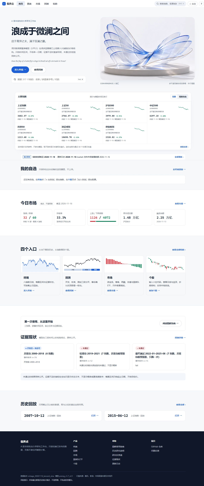
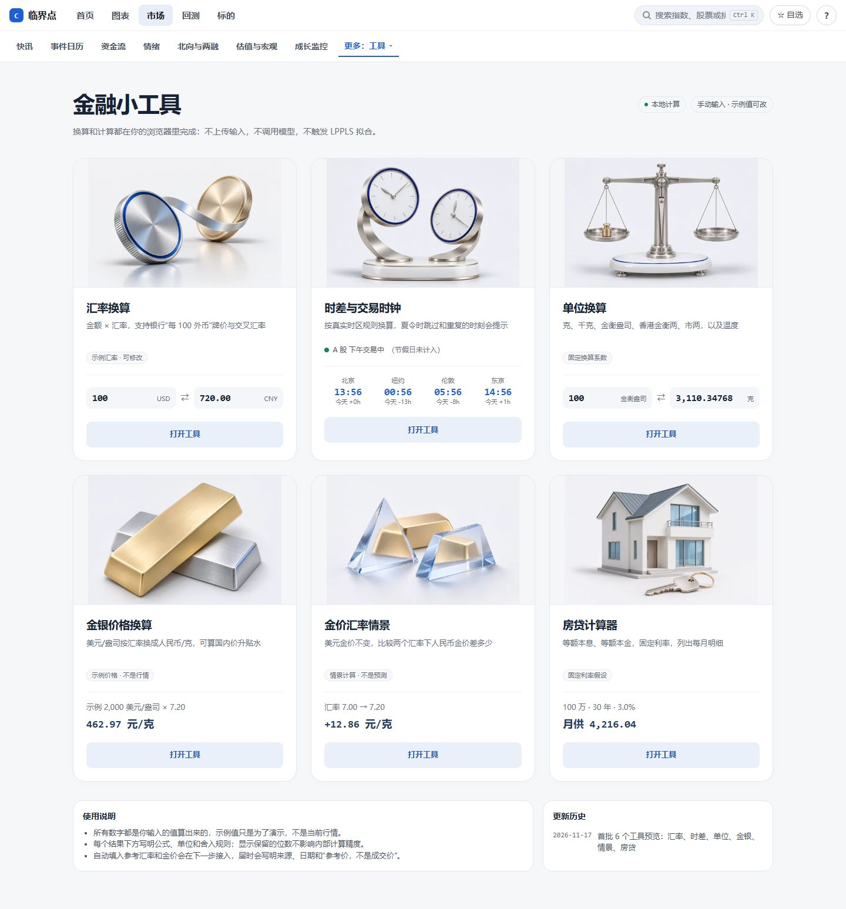

# 配图与页面集成验收 · 2026-11-17

## 交付与边界

主线基准 b69384656210cc3610e58733426ce22bc8a69d6e；本变更在工具页 PR #125 的 1546c40128f1413cce8da89028e578465dc6406e 上追加。提交目标为 main 的独立 Draft PR，依赖 #125；不要并行合并两份工具页实现。未合并、部署或发布。

新增 7 张生成式静物主图（首页 1、工具 6）、14 个 WebP 尺寸版本、3 张教程 SVG；每张的编号、用途、位置、提示词、替代文本策略与文件哈希见 [素材目录](visual-suite-20261117.md) 和 [manifest](../assets/visual-suite/manifest.json)。这些是原创生成的装饰或操作示意，不能用来替换行情图、预测图或证据。

## 实际检查结果

| 检查 | 状态 | 证据与范围 |
|---|---|---|
| 首页／工具／教程，1440×900 | VERIFIED | IAB 浏览器实测，页面图片均正常加载；见下面截图 |
| 首页／工具／教程，390×844 | VERIFIED | 稳定布局的 document scrollWidth=375、innerWidth=390（15px 桌面滚动条），无横向溢出；手机工具按钮高度44px |
| 六个工具打开／关闭 | VERIFIED | 汇率、时差、单位、金银、情景、房贷均实际打开、读取结果、关闭 |
| 汇率交互 | VERIFIED | 金额改为200、示例汇率7.2时，显示1,440.0000 CNY；示例输入不是当前行情 |
| 房贷两种方式 | VERIFIED | 390px下切换等额本金：100万、30年、3%时首月5,277.78元、末月2,784.72元；固定利率示例 |
| 教程章节与图解 | VERIFIED | 三图加载、章节链接可操作；手机通过同义HTML解释和原图链接阅读。缩小SVG中的细字不作为手机直接可读验收 |
| 真实首页图表 | VERIFIED | 原t1–t4数据入口和SVG保留；本机预览经原LPPL数据层读取已发布静态数据。没有用生成图片填行情 |
| 计算回归 | VERIFIED | 原tools-calc.test.cjs 7项通过；视觉fallback与减少动效回归5项通过 |
| 图片错误恢复 | VERIFIED | 单元回归覆盖error→load解除fallback，缓存失败与再次失败；非浏览器断网实测 |
| 减少动效与指针 | VERIFIED（代码及单元） | reduced-motion/coarse pointer不调RAF；fine pointer限幅，离开归零。真实触屏/系统无障碍设置 NOT_INSPECTED |
| 数据隔离 | VERIFIED（静态） | 未改lppl-data.js、tools-calc.js、Worker或模型；首页仅修正骨架/失败布局，其余数据脚本不变 |
| 全仓CI／生产／Safari／真实手机／低带宽 | NOT_INSPECTED（本地阶段） | 不能据三页验收宣称全站验收或线上已生效；远端CI状态见PR |

首页静态数据源配置仅由临时本机验收服务器注入，不属于提交内容；没有触发模型计算、历史回放或外部写入数据。

## 页面截图

### 首页

[390px 首页](visual-evidence/home-390.jpg)

### 工具页

[390px 工具页](visual-evidence/tools-390.jpg)

### 教程

[桌面教程](visual-evidence/guide-desktop.jpg) · [390px 教程](visual-evidence/guide-390.jpg)

## Devin 接续操作

1. 先确认 #125 的合并状态；本PR沿用其工具代码，避免重复实现六个计算器。
2. 按素材目录中的selector放置图片，不改成背景视频，不把静物当成实时数据。运行时只用WebP，PNG用于后续修图。
3. 首页、帮助菜单均进入guide.html；原lab/guide.html留作历史研究说明。
4. 本PR可独立回退视觉层：home/tools布局、visual-suite.css/js、新guide及素材；计算器与模型无需改动。
5. 发布前另做全站导航、Safari、真实390px设备、低带宽、生产路径和缓存策略检查。当前不部署。

## 本地图片留存

按用户要求：只有远端提交和每个素材的Git blob SHA逐项核对一致后，才删除本次生成的本地原图、复制件、派生图和验收截图归档。用户原始文件、此前项目素材、聊天、研究数据和代码不在删除范围内。实际删除清单与字节数保留在本地交付回执；远端是这些配图的正式存档。
