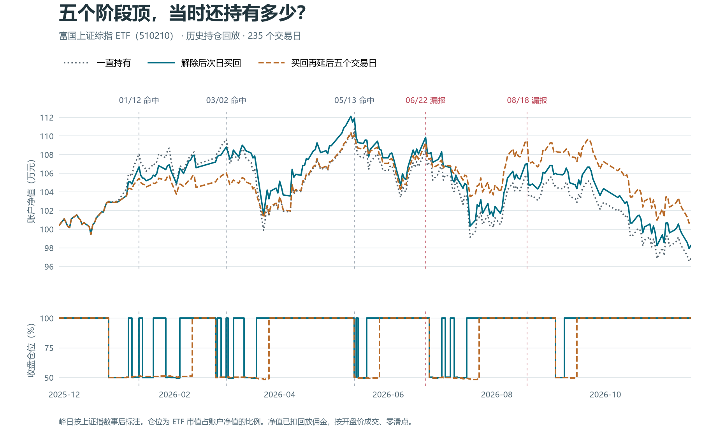

# 14 次阶段顶提醒的持仓回放

**优先检验解除后的回补规则，同时保留两次漏报作独立问题。** 235 个交易日内，原规则提前覆盖 5 个上证阶段顶中的 3 个。按下一开盘减半、解除后下一开盘买满，1 月 12 日和 3 月 2 日真正见顶时已接近满仓。只有 5 月 13 日收盘仍持有约半仓。将回补推迟五个额外交易日，同一组提醒在这三个顶上都保住了半仓左右。6 月 22 日和 8 月 18 日两种方案都几乎满仓。**VERIFIED · 已封存数据的历史模拟。**

## 组合结果

2025-11-28 开盘至 2026-11-18 收盘，初始资金各 1,000,000 元。三组同价购买 1,038,100 份 510210，初买价 0.963 元，佣金 249.92 元。尾日均按 0.933 元收盘估值。表中减半日数按收盘仓位低于 75% 计。最大回撤从账户此前最高收盘净值算起。

| 执行方式 | 期末净值（元） | 全期收益 | 相对持续持有（元） | 最大回撤 | 成交笔数 | 总佣金（元） | 减半日数 |
| --- | ---: | ---: | ---: | ---: | ---: | ---: | ---: |
| 持续持有 | 968,607.08 | −3.14% | 0.00 | 12.84% | 1 | 249.92 | 0 |
| 主方案 · 解除后下一开盘接回 | 982,417.00 | −1.76% | +13,809.92 | 12.66% | 29 | 3,995.00 | 45 |
| 单项对照 · 解除后多等 5 个交易日 | 1,009,696.47 | +0.97% | +41,089.39 | 8.82% | 11 | 1,582.13 | 91 |

**怎样理解这 27,279.47 元的差异。** 延后规则只改回补时点。等待中又有新提醒就继续持有原仓位，把 14 次提醒串成 5 段减仓。其平均收盘仓位为 80.67%，主方案是 90.41%。这段下跌样本里，延后方案同时降低了持仓天数和佣金。结果支持继续检验回补时机，尚不能把优势全部归于择时能力。**VERIFIED** 为净值和仓位差异，**NOT_ESTABLISHED** 为跨牛熊样本的优势。



## 逐笔还原减仓和买回

每行是一组收盘提醒到解除的完整交易。卖出和买回栏各列“成交月日 · 元/份 × 成交份数”。第一笔卖出在 2025 年，其余成交均在 2026 年。区间净贡献以卖出的那批份额持续持有至买回开盘为参照，正数表示减仓节约的钱，负数表示少赚或多付的钱。价格变动与成交费用分别可在账本核查。[逐次提醒](episodes.csv) · [每笔费用、现金净变动和成交后剩余份数](fills.csv) · [逐日持仓](daily_positions.csv)

| 序 | 提醒收盘日 | 增强 | 卖出日 · 价 × 份 | 解除收盘 | 买回日 · 价 × 份 | 双边费用（元） | 区间净贡献（元） | 原评分说明 |
| ---: | --- | --- | --- | --- | --- | ---: | ---: | --- |
| 1 | 2025-12-25 | 12-26 | 12-26 · 0.991 × 519,100 | 01-05 | 01-06 · 1.006 × 511,100 | 257.15 | -8,043.65 | 窗口无顶 |
| 2 | 2026-01-07 | — | 01-08 · 1.018 × 515,100 | 01-09 | 01-12 · 1.028 × 509,800 | 262.11 | -5,413.11 | 命中 01-12 |
| 3 | 2026-01-13 | 01-15 | 01-14 · 1.03 × 512,400 | 01-19 | 01-20 · 1.027 × 513,700 | 263.83 | +1,273.37 | 窗口无顶 |
| 4 | 2026-01-26 | 01-30 | 01-27 · 1.037 × 513,100 | 02-03 | 02-04 · 1.019 × 521,900 | 265.97 | +8,969.83 | 窗口无顶 |
| 5 | 2026-02-13 | — | 02-24 · 1.035 × 517,500 | 02-24 | 02-25 · 1.037 × 516,200 | 267.72 | -1,302.72 | 命中 03-02 |
| 6 | 2026-02-26 | — | 02-27 · 1.04 × 516,800 | 02-27 | 03-02 · 1.046 × 513,600 | 268.68 | -3,369.48 | 重复覆盖 03-02 |
| 7 | 2026-03-02 | 03-03 | 03-03 · 1.056 × 515,200 | 03-05 | 03-06 · 1.032 × 526,900 | 271.95 | +12,092.85 | 重复覆盖 03-02 |
| 8 | 2026-03-11 | 03-12 | 03-12 · 1.044 × 521,100 | 03-18 | 03-19 · 1.017 × 534,700 | 271.96 | +13,797.74 | 窗口无顶 |
| 9 | 2026-05-12 | — | 05-13 · 1.053 × 527,900 | 05-13 | 05-14 · 1.068 × 520,200 | 277.86 | -8,196.36 | 命中 05-13 |
| 10 | 2026-05-14 | 05-15 | 05-15 · 1.047 × 524,000 | 05-19 | 05-20 · 1.04 × 527,300 | 274.26 | +3,393.74 | 窗口无顶 |
| 11 | 2026-06-23 | 06-24 | 06-24 · 1.025 × 525,700 | 06-30 | 07-01 · 1.024 × 525,900 | 269.34 | +256.36 | 窗口无顶 |
| 12 | 2026-07-02 | — | 07-03 · 1.012 × 525,800 | 07-03 | 07-06 · 1.02 × 521,500 | 266.01 | -4,472.41 | 窗口无顶 |
| 13 | 2026-07-07 | 07-08 | 07-08 · 1.005 × 523,600 | 07-14 | 07-15 · 0.998 × 527,000 | 263.04 | +3,402.16 | 窗口无顶 |
| 14 | 2026-09-02 | 09-04 | 09-03 · 1.01 × 525,300 | 09-07 | 09-08 · 1.005 × 527,600 | 265.20 | +2,361.30 | 窗口无顶 |

**11 次未获独立命中计分的提醒。** 从实际卖出日至回补开盘，3 次买贵，卖出的份额共错过 15,093.70 元上涨。8 次买回更便宜，共避开 47,692.90 元下跌。扣除 2,937.39 元双向佣金，区间净贡献为 **+29,661.81 元**。最明显的途中踏空是 7 月 7 日提醒，卖出份额按等待期间最高价一度少赚 9,948.40 元，最终仍以较低开盘价回补。途中高点用作持仓体验，不作为可成交退出价，也不跨事件相加。**VERIFIED。**

**原评分的“误报”有两类。** 9 次窗口内没有可评阶段顶。另外 2 次，即 2 月 26 日和 3 月 2 日，其十日窗口均覆盖 3 月 2 日，但最早的 2 月 13 日提醒已获该峰的唯一命中。一个是重复提前提醒，一个是顶日收盘才触发、随后次日减仓。评估投资者界面时应把重复提醒和全新提醒区分呈现。原标签和 14 次交易全部保留。[原始评分](../breadth_trend_20261118/panel_v2_outcomes.json)

**与期末持续持有对账。** 三次命中的减仓也都买贵，双向费用合计 807.69 元，区间净贡献 −14,912.19 元。14 次回补后剩余份数都可能改变，此后直到期末产生的份额差损益合计 −939.70 元。29,661.81 − 14,912.19 − 939.70 = **13,809.92 元**。按期末计，11 次未获命中计分合计贡献 +27,043.91 元，3 次获命中计分合计贡献 −13,233.99 元。主方案最终持有 1,052,900 份和 61.30 元现金，持续持有组持有 1,038,100 份和 59.78 元现金。**VERIFIED。**

## 真正见顶时还剩多少仓位

峰日是上证综指按旧规则事后确认的收盘阶段顶，仓位按 ETF 开盘成交后及收盘时的账户财富计算。五峰均经过原评价器的右侧成熟检验。命中提前量分别为 3、5、1 个交易日，只有一次达到至少 5 日。

| 上证阶段顶 | 首次命中提醒 | 提前交易日 | 主方案峰日份数 | 开盘仓位 | 收盘仓位 | 延后回补收盘仓位 |
| --- | --- | ---: | ---: | ---: | ---: | ---: |
| 2026-01-12 | 01-07 | 3 | 1,024,800 | 99.99% | 99.99% | 51.23% |
| 2026-03-02 | 02-13 | 5 | 1,030,400 | 99.99% | 99.99% | 50.51% |
| 2026-05-13 | 05-12 | 1 | 527,800 | 50.00% | 50.33% | 50.33% |
| 2026-06-22 | 漏报 | — | 1,051,300 | 100.00% | 100.00% | 99.99% |
| 2026-08-18 | 漏报 | — | 1,050,600 | 100.00% | 100.00% | 99.99% |

百分数四舍五入，“100.00%”仍可能剩有少量现金。1 月 9 日收盘解除，1 月 12 日开盘接回。2 月 24 日开盘才执行节前提醒，当天收盘即解除，次日买回，2 月 26 日再报、27 日再解除，导致 3 月 2 日早盘再次买满。5 月 13 日开盘已减半，当日解除在 14 日开盘才执行。[五峰逐日口径和原始精度](peaks.csv)

## 两次漏报付出的代价

以各策略在同一峰日的收盘净值为起点，考察随后 20 个交易日，列出期间最低收盘净值相对起点的跌幅。金额按各自峰日持仓计算。不同资金路径的最低点可能落在不同日期。

| 峰日与观察截止 | 主方案从峰日损失 | 持续持有从峰日损失 | 延后回补从峰日损失 |
| --- | ---: | ---: | ---: |
| 06-22 → 07-20 | 95,311.39 元 / 8.68%（07-17） | 93,429.00 元 / 8.61%（07-17） | 57,632.97 元 / 5.27%（07-17） |
| 08-18 → 09-15 | 27,315.60 元 / 2.55%（08-24） | 29,066.80 元 / 2.75%（09-15） | 27,931.80 元 / 2.55%（08-24） |

6 月 23 日收盘才出现下一条预警，24 日开盘才减仓。延后方案在峰后横跨 7 月初多次提醒，保护了一部分下跌。8 月 18 日之后直到 9 月 2 日才再报，首轮跌势中两种执行法都接近满仓。8 月 24 日同日对比，主方案和持有基准从各自峰日下跌均约 2.55%。两次漏报都应原样列入提醒层的漏报分母。**VERIFIED。**

## 费用、可成交性与适用边界

- **VERIFIED**。标的为跟踪上证综指的富国 ETF 510210。封存的 236 根未复权日线逐日对齐指数日历，首根为 11 月 27 日，原面板从 28 日可评价，实际入账 235 日。前 235 根四价与 Yahoo 核对，最后一日采用英为财情补核。管理人分红表及分红拆分记录显示样本内零公司行动。[行情证据和原始摘要](quote_provenance.md)
- **公开收费模拟**。国金 2025 和 2026 年开户协议对场内基金均列双边万分之二点五、每笔最低 5 元。成交额乘费率后按笔到分。ETF 二级交易无股票印花税，含规佣金不重复收经手费。基金管理、托管费已体现在基金资产中。按每手 100 份、现金账户模拟，现金不计息。**NOT_INSPECTED** 为个人交割单与开盘竞价实际可得的成交量。[2025 年协议](https://www.gjzq.com.cn/upload/file/202506/%E4%BD%A3%E9%87%91%E5%AE%9D%E5%AE%98%E7%BD%91%E5%BC%80%E6%88%B7%E5%8D%8F%E8%AE%AE2657035318.pdf) · [2026 年协议](https://www.gjzq.com.cn/upload/file/202603/%E4%BD%A3%E9%87%91%E5%AE%9D%E5%AE%98%E7%BD%91%E5%BC%80%E6%88%B7%E5%8D%8F%E8%AE%AE2457089198.pdf) · [上交所 ETF 投教](https://etf.sse.com.cn/fund/learning/download/c/10055613/files/32901abf70d54e999f46975b52ba46de.pdf) · [券商费用公示](https://www.tpyzq.com/main/aboutus/xxgs/fyxxgs/index.shtml)
- **VERIFIED · 成本敏感性**。保持零滑点、每笔最低 5 元，单边万一、万二点三、万二点五、万五时，主方案分别领先持续持有 15,881.65、14,089.32、13,809.92、10,370.81 元。另对每笔开盘报价加每边 5 个基点的不利滑点，按基金最小价位 0.001 元就近取整，每笔实际偏移可能为零或一档。主方案终值降至 970,081.17 元，相对持有只剩 **+1,474.09 元**，最大回撤 13.13%；延后方案终值 1,006,752.05 元。日线无法核实每笔真实冲击。[完整敏感性结果](summary.json)
- **研究假设**。100 万元初始资金、提醒减至 50% 和延后五日均为本轮冻结的执行设定。增强仅留痕。指数阶段顶的 10 日观察窗、126 日回看和 20 日右侧确认沿用原评分。阶段顶成功不附带价格跌幅条件。这次只评估市场宽度面板的阶段顶提醒，未重新拟合 LPPLS。[先冻结的方案](../../docs/stage-etf-position-protocol.md) · [原评分实现](../../research/eval/breadth_trend_study.py)
- **NOT_ESTABLISHED**。原档的 `first_publication_at` 为空，无法证明当年有用户在下一开盘前收到过这些提示。11 月 18 日之后的前瞻样本、不同市场周期的稳定性、5 日是否最优、个人账户可实现收益，均待验证。**VERIFIED** 指给定冻结输入的可复算性。

## 给 Devin 的交接

1. 维持 `stage-breadth-2` 的 14 个原始提醒 ID、37 条状态变化和旧评分。界面分别展示“风险仍在观察”“解除原提醒”“模拟买回时间”。买回规则应有自己的研究版本与可用时间戳。
2. 冻结两种回补作为未来对照，按相同提醒并行记录。主指标用峰日仓位、峰后 20 日损失和逐笔错过上涨，另报平均仓位、低仓日数、佣金、滑点及同暴露基准。仅 5 个顶的历史数据不足以选择生产参数。
3. 单列漏报研究。6 月 22 日追查为什么提醒晚一天，8 月 18 日追查其前后阶段与市场宽度有无可用异常。把它们标为已看过的解释案例。任何新规则以之后未查看的样本检验，保留本报告基线。

## 复现与验收

从仓库根目录执行。第一条命令下载有固定 SHA-256 的行情文件，也支持用已封存的原响应离线重建。预检交易日历、事件账本、原评分和行情指纹后才运行；校验失败会停止。原始行情供应商的整段数据仅在本机留存。

```powershell
. D:\CodexData\config\analysis-env.ps1
$bars = Join-Path $env:CODEX_ANALYSIS_WORK '510210_ohlc.csv'
python research/data/stage_etf_quote_sample.py --output $bars
python -m research.eval.stage_etf_positions run --bars $bars --corporate-actions reports/stage_etf_20261118/corporate_actions.csv --out reports/stage_etf_20261118
python -m pytest tests/test_stage_etf.py tests/test_stage_etf_positions.py
python -m research.eval.plot_stage_etf_positions
```

冻结投影亦可从[原 CI 归档](https://github.com/CareyPang/LPPL/actions/runs/44483890641)的 `panel_changes.json` 和 [stock-results 固定版本的上证档案](https://github.com/CareyPang/LPPL/blob/9430d1dda8937833501cb26150b1e6ff767f1cf5/index/sh000001_latest.json)重建。运行 `python -m research.eval.stage_etf_positions freeze --changes <原变化文件> --index <原指数文件>`。研究日历与状态投影随仓库保存，可直接从上面的回放命令开始。

核验覆盖初始同单、信号收盘至下一交易日开盘、整手和费用、现金守恒、解除与新预警衔接、峰日仓位、机会成本与终值之和。另以独立 Decimal 脚本直接读取原始状态变化和行情，复核了主方案与持有组的终值、五个峰日仓位和两次漏报最大损失。
